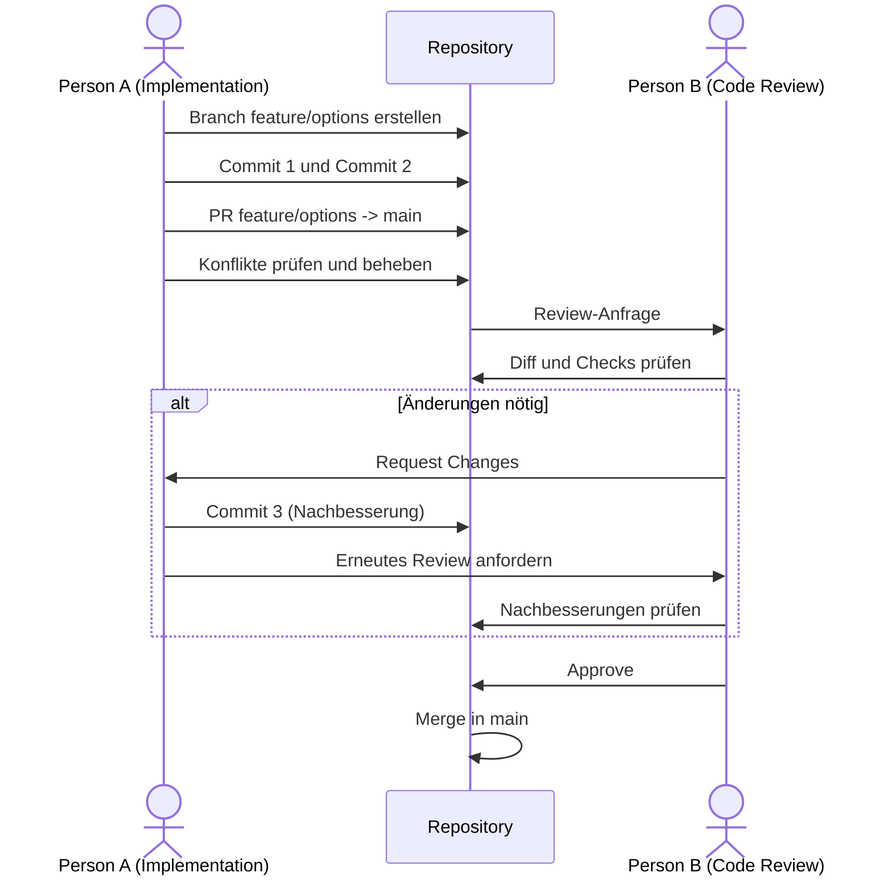

# eVote – Online-Abstimmungssystem für Bürgerbefragungen

## 5. eVote: Online-Abstimmungssystem für Bürgerbefragungen

Eine sichere Plattform für Online-Abstimmungen, bei der Bürger über städtische Entscheidungen oder Projekte abstimmen können.

### Funktionale Anforderungen

- **Nutzerregistrierung und Authentifizierung:** Registrierung für Bürger mit gesicherter Authentifizierung (z. B. durch E-Mail-Bestätigung oder 2-Faktor-Authentifizierung).
- **Abstimmungen anzeigen:** Bürger können verfügbare Abstimmungen mit den zugehörigen Fragestellungen und Antwortmöglichkeiten einsehen.
- **Stimme abgeben:** Bürger können an aktiven Abstimmungen teilnehmen und ihre Stimme abgeben.
- **Einmalige Stimmabgabe:** Das System stellt sicher, dass jeder berechtigte Bürger pro Abstimmung nur einmal abstimmen kann.
- **Abstimmungen verwalten:** Berechtigte Personen können Abstimmungen erstellen, bearbeiten, veröffentlichen und beenden.
- **Abstimmungszeitraum festlegen:** Für jede Abstimmung können ein Start- und ein Endzeitpunkt festgelegt werden.
- **Ergebnisse auswerten:** Das System zählt die abgegebenen Stimmen automatisch aus.
- **Ergebnisse anzeigen:** Die Ergebnisse abgeschlossener Abstimmungen können angezeigt werden.
- **Benutzerverwaltung:** Berechtigte Personen können Benutzerkonten verwalten.
- **Sichere Datenspeicherung:** Abstimmungsdaten und Stimmen werden gespeichert und vor unbefugtem Zugriff geschützt.

# Git-Handout für Anfänger

## 1. Was ist Git?

Besonders bei der gemeinsamen Entwicklung von Software ist Git hilfreich, weil mehrere Personen gleichzeitig an einem Projekt arbeiten können. Änderungen werden dokumentiert und können über Branches und Pull Requests kontrolliert zusammengeführt werden.

Git unterscheidet grundsätzlich zwischen einem lokalen Repository auf dem eigenen Computer und einem Remote Repository, das beispielsweise auf GitHub oder GitLab liegt.

## 2. Was ist GitHub?

GitHub ist eine Plattform im Internet, auf der Git-Repositorys gespeichert werden können.

Git selbst ist das Versionskontrollsystem.

GitHub ist eine Plattform, die Git verwendet und zusätzliche Funktionen für die Zusammenarbeit anbietet.

Dazu gehören zum Beispiel:

- gemeinsame Repositorys
- Branches
- Pull Requests
- Code Reviews
- Issues

Eine andere bekannte Plattform ist GitLab.


## 3. Was ist ein Repository?
Ein Repository, kurz „Repo“, ist einfach der Projektordner, den Git verwaltet.
Zum Beispiel habt ihr auf eurem Computer:

```
Git-Handout/
├── README.md
└── .gitignore
```

Git merkt sich zusätzlich, welche Änderungen an diesen Dateien vorgenommen wurden.

Es gibt zwei wichtige Arten von Repositorys:

### Lokales Repository:
Das Repository liegt auf deinem eigenen Computer.

### Remote Repository:
Das Repository liegt auf einem Server im Internet, zum Beispiel bei GitHub oder GitLab.

Man kann sich das ungefähr so vorstellen:

Dein Computer
     |
     |  push / pull
     |
     ↓
GitHub / GitLab


### 2.1 Repository erstellen und klonen

Für unsere Aufgabe erstellt ein Teammitglied ein gemeinsames Repository auf GitHub oder GitLab.

Alle Teammitglieder müssen Zugriff auf das Repository haben.

Anschließend wird das Repository auf den eigenen Computer heruntergeladen. 

Dafür verwendet man:

``` git clone <URL> ```

Klonen bedeutet, eine Kopie eines Remote Repositorys auf den eigenen Computer herunterzuladen.

Danach besitzt man ein lokales Repository, mit dem man arbeiten kann.

Wenn Git Bash benutzt wird, wird das Repository in dem Ordner angelegt, von dem Git Bash geöffnet wurde.

Um in der Zukunft in dem Repository zu arbeiten (für pulls oder commits beispielsweise), muss Git Bash dann entsprechend in dem neuen Ordner des Repository geöffnet werden.

### Was ist Git init?

Mit ```git init``` wird ein neues Git-Repository erstellt.

Der Befehl wird verwendet, wenn man einen normalen Ordner in ein Git-Projekt umwandeln möchte.

Beispiel:
```
mkdir mein-projekt
cd mein-projekt
git init
```
Danach kann Git die Änderungen in diesem Ordner verfolgen.

Wenn man ein bereits bestehendes Repository mit ```git clone``` herunterlädt, ist ```git init``` normalerweise nicht mehr notwendig.

### Was ist die .gitignore?

Die Datei ```.gitignore``` sagt Git, welche Dateien nicht gespeichert bzw. verfolgt werden sollen.

Man möchte zum Beispiel nicht jede Datei eines Programms in Git speichern.

Typische Beispiele sind:
.idea/
.DS_Store

```.idea/``` enthält Einstellungen von IntelliJ IDEA oder PyCharm.

```.DS_Store``` wird von macOS automatisch erstellt.

Die ```.gitignore``` verhindert, dass solche Dateien versehentlich in das Repository aufgenommen werden.

### Was ist eine ```README.md?```

Eine README ist eine Datei, die Informationen über ein Projekt enthält.

Die Endung .md bedeutet Markdown.

Markdown ist eine einfache Möglichkeit, Texte zu formatieren.

Eine README kann zum Beispiel erklären:

-Was ist das Projekt?

-Wie funktioniert es?

-Wie kann man es installieren?

-Wie kann man es benutzen?

In dieser Aufgabe wird die README als Git-Handout verwendet.
### Was ist ein commit?
Ein Commit ist ein gespeicherter Stand eines Projekts.

Man kann sich einen Commit wie einen Speicherpunkt vorstellen.

Beispiel:

Commit 1
README erstellt

Commit 2
Git-Befehle ergänzt

Commit 3
Branching erklärt

Durch die Commits kann man später nachvollziehen, welche Änderungen vorgenommen wurden.

Ein Commit wird beispielsweise mit folgendem Befehl erstellt:

```git commit -m```  "Git-Befehle ergänzt"

Der Text hinter ```-m``` ist die Commit-Nachricht.

Sie beschreibt kurz, was geändert wurde.

Eine gute Commit-Nachricht wäre:

```git commit -m "Abschnitt zu Branches ergänzt"```
### Was ist ```git status?```

Mit ```git status``` kann man sehen, was gerade im Repository passiert.

Zum Beispiel zeigt Git:

-welche Dateien geändert wurden,
-welche Dateien neu sind,
-welche Änderungen noch nicht gespeichert wurden,
-auf welchem Branch man sich befindet.

```git status``` ist deshalb ein sehr nützlicher Befehl.
### Was ist ```git add?```

Bevor eine Änderung committed werden kann, muss man Git mitteilen, welche Änderungen zum nächsten Commit gehören.

Dafür verwendet man: ```git add datei.txt```

Oder für alle Änderungen: ```git add .``` , das bedeutet:

„Diese Änderung möchte ich beim nächsten Commit speichern.“

Die Änderung wird dadurch noch nicht endgültig als Commit gespeichert.

### Was ist git commit?

Nach ```git add``` kann ein Commit erstellt werden:

```git commit -m "README ergänzt"```

Damit wird der aktuelle Stand der ausgewählten Änderungen gespeichert.

Der Ablauf ist also:

Datei verändern
      ↓
  ``` git add```
      ↓
 ``` git commit```
## 4. Arbeiten mit Branches
## Was ist ein Branch?

Ein Branch ist ein eigener Entwicklungszweig.

Man kann sich einen Branch wie eine separate Arbeitsversion des Projekts vorstellen.

Der Haupt-Branch heißt häufig:

```main```

Wenn mehrere Personen gleichzeitig arbeiten, sollte nicht jeder direkt im main-Branch Änderungen machen.

Stattdessen erstellt jede Person einen eigenen Branch:
```
main
 ├── norma
 ├── Leo
 └── feli
```
So kann jede Person unabhängig arbeiten.


## Branch erstellen und wechseln

Mit ```git switch -c mein-branch``` wird ein neuer Branch erstellt und direkt zu diesem Branch gewechselt.

Zum Beispiel:

```git switch -c norma-readme```

Jetzt arbeitet man im Branch ```norma-readme.```

Mit ```git branch``` kann man sehen, welche Branches vorhanden sind.
Mit ```git switch main``` wechselt man zurück zum main-Branch.

Zum eigenen Branch kommt man beispielsweise mit: ```git switch norma-readme```

## Was bedeutet Merge?
Merge bedeutet Zusammenführen.

Wenn die Arbeit auf einem Branch fertig ist, können die Änderungen mit dem main-Branch zusammengeführt werden.

Beispiel:
```
main
  \
   norma-readme
       |
       | Änderungen
       ↓
      Merge
       |
       ↓
      main
```

Nach dem Merge befinden sich die Änderungen aus norma-readme auch im main-Branch.

# Merge-Konflikte lösen
Ein Merge-Konflikt entsteht, wenn Git nicht automatisch entscheiden kann, welche Änderung übernommen werden soll.

Beispiel:

Person A schreibt:

Git ist ein Versionskontrollsystem.

Person B verändert dieselbe Stelle zu:

Git ist ein System zur Versionsverwaltung.

Wenn beide Änderungen zusammengeführt werden sollen, weiß Git nicht, welche Version verwendet werden soll.

Git markiert die Stelle dann beispielsweise so:
```
<<<<<<< HEAD
Git ist ein Versionskontrollsystem.
=======
Git ist ein System zur Versionsverwaltung.
>>>>>>> anderer-branch
```

Man muss dann selbst entscheiden, welche Version verwendet werden soll. Danach werden die Markierungen entfernt und die Datei gespeichert.

Anschließend:

```git add .```
```git commit -m "Merge-Konflikt gelöst"```

## Git mit IntelliJ/PyCharm benutzen: Local Repository und Remote Repository
## Nützliche Git-Tools und Plabormen (z. B. GitHub)

## 6. Typischer Git-Workflow
1. Repository klonen
2. Neuen Branch erstellen
3. Änderungen durchführen
4. Commit erstellen
5. Push
6. Pull Request erstellen
7. Review
8. Merge
9. Branch wird gelöscht

## 7. Zusammenarbeit im Team
### Ablauf von Pull Requests

Ein Pull Request (PR) ist eine Anfrage, die Änderungen eines Branches in einen anderen Branch zu mergen. Die Änderungen müssen vorher von einer weiteren Person geprüft und freigegeben werden.

**Beispiel:** Person A implementiert ein neues Feature im Branch `feature/checkout-options` und möchte es in den Zielbranch (z. B. `main` oder `development`) mergen. Damit keine ungeprüften Änderungen ohne Zustimmung ins Projekt gelangen, prüft in der Regel eine Person B die Änderungen und weist ggf. auf Fehler oder Breaking Changes hin. In diesem Fall wird der PR nicht freigegeben (not approved), muss überarbeitet werden und geht erneut ins Code Review. Dieser Zyklus wiederholt sich, bis der PR freigegeben ist. Anschließend wird er automatisch oder manuell in den Zielbranch gemergt.

**Merge-Konflikte:** Sowohl im Code Review als auch in automatischen Git-Checks fallen vor dem Merge Konflikte auf. Diese müssen im Feature-Branch behoben werden. Häufig wird dazu der Zielbranch erneut in den Feature-Branch gemergt, weil dort durch andere PRs neue Änderungen entstanden sind, die der Feature-Branch noch nicht enthält. Alternativ ist auch ein Rebase des Feature-Branches auf den Zielbranch möglich.


**Beispielablauf:**



### Code Reviews
**Ziel:**
- Fehler, Sicherheitslücken und Breaking Changes früh erkennen
- Codequalität, Lesbarkeit, Wartbarkeit, Einhaltung von standards (z.b. FDD)
- Wissen im Team verteilen (Code wird von mehr als einer Person verstanden)
- Wartbarkeit und Testabdeckung sichern


**Worauf wird geachtet:**
- Korrektheit: Tut der Code, was er soll? Werden Randfälle behandelt?
- Lesbarkeit: Sind Namen, Struktur und Kommentare verständlich?
- Konsistenz: Passt die Änderung zu Architektur und Code-Style des Projekts?
- Tests: Sind neue oder angepasste Tests vorhanden, laufen die automatischen Checks durch?
- Sicherheit und Performance: Gibt es offensichtliche Risiken oder Engpässe?
- Umfang: Ist der PR fokussiert und nicht unnötig groß?

**Ergebnisse des Reviews:**
- PR ist approved und wird für merge freigegeben
- Anmerkung als Kommentare ohne entscheidung
- Änderungsanfrage, änderungen sind notwendig und PR wird dann erneut geprüft

### Gute Commit-Nachrichten

**Regeln**
- Betreff im Imperativ, kurz, ohne Punkt am Ende ("Add checkout options")
- Ein Commit pro logischer Änderung, Code danach lauffähig
- Body erklärt das Warum, nicht jede Codezeile
- Ticket referenzieren, z. B. `Closes #42`

**Conventional Commits:** `<type>(<scope>): <beschreibung>`

| Type | Verwendung |
|---|---|
| `feat` | Neues Feature |
| `fix` | Fehlerbehebung |
| `docs` | Dokumentation |
| `refactor` | Umbau ohne Verhaltensänderung |
| `test` | Tests |
| `chore` | Build, Tooling, Abhängigkeiten |

Breaking Changes mit `!` oder Footer `BREAKING CHANGE:` markieren.

**Beispiele**

Schlecht: `fix`, `wip`, `Fixed stuff`

Gut: `feat(checkout): add shipping options selection`, `fix(cart): prevent crash when cart is empty`

## 8. Beitrag der Teammitglieder
- Person 1: ...
- Person 2: ...
- Person 3: ...
