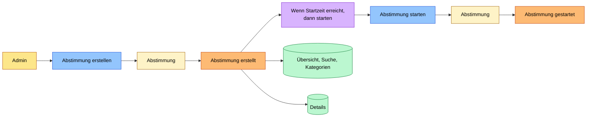
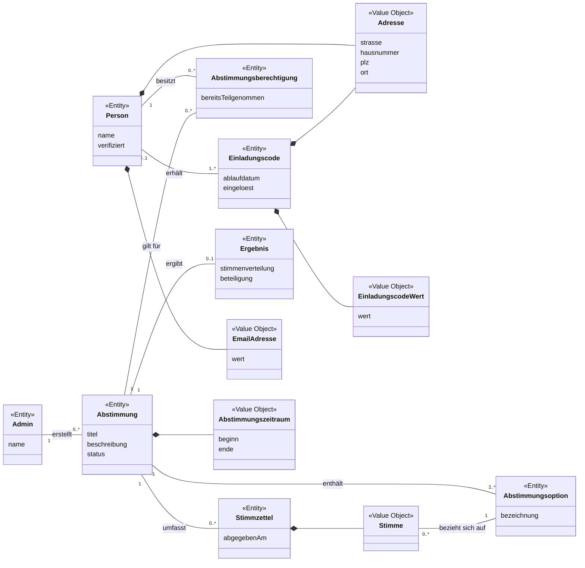
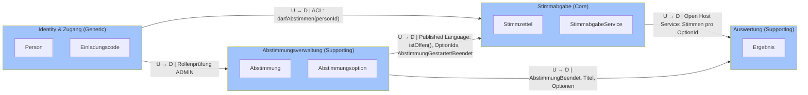
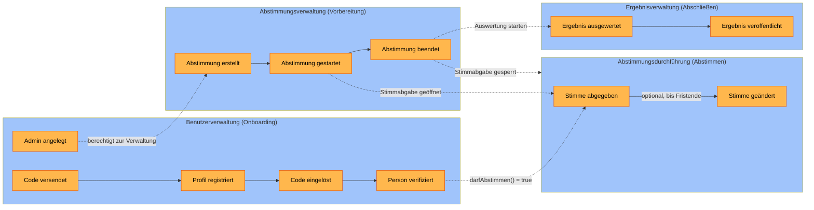
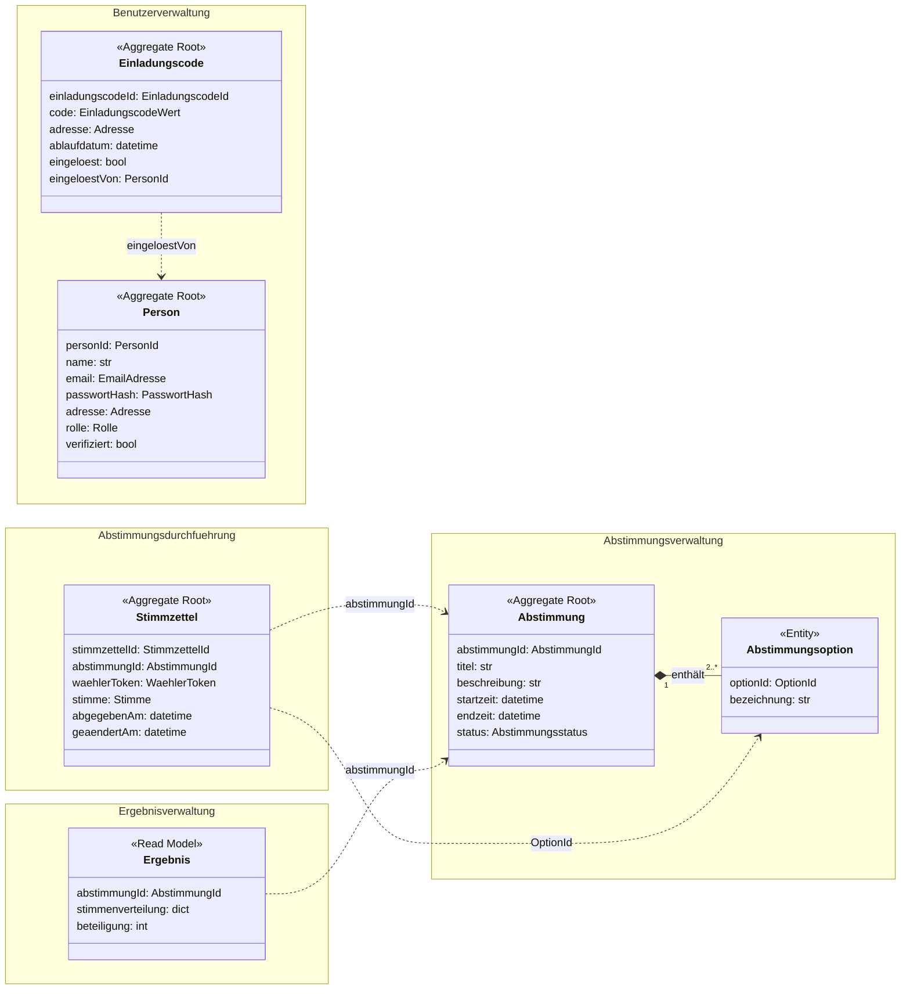

# Übung 3: Systemarchitektzur Ihres Projekts modellieren

## 1. Event Storming: eVote

### Legende

Durchgezogene Pfeile zeigen den Ablauf, gestrichelte Linien Bezüge (z. B. Hotspot zu einem Command).
(Farben mit eingetragen, da @Leo eine Farbsehschwäche hat.)

### Phase 1: Onboarding

### Phase 2: Vorbereiten

### Phase 3: Abstimmen

### Phase 4: Abschließen

```mermaid
flowchart LR
  sys["System (Zeit)"]:::actor --> p_end["Wenn Endzeit erreicht,<br>dann beenden"]:::policy --> c_end["Abstimmung beenden"]:::command --> ag_ab3["Abstimmung"]:::aggregate --> e_ended["Abstimmung beendet"]:::event
  e_ended --> p_eval["Wenn beendet,<br>dann auswerten"]:::policy --> c_eval["Ergebnis auswerten"]:::command --> ag_ab4["Abstimmung"]:::aggregate --> e_eval["Ergebnis ausgewertet"]:::event

  e_eval --> ad4["Admin"]:::actor --> c_pub["Ergebnis veröffentlichen"]:::command --> ag_ab5["Abstimmung"]:::aggregate --> e_pub["Ergebnis veröffentlicht"]:::event
  e_pub --> rm_res[("Ergebnisansicht")]:::readmodel
  h_zw>"Zwischenergebnisse sichtbar?"]:::hotspot -.- rm_res

  classDef actor fill:#fde68a,stroke:#b45309,color:#000
  classDef command fill:#93c5fd,stroke:#1d4ed8,color:#000
  classDef aggregate fill:#fef3c7,stroke:#a16207,color:#000
  classDef event fill:#fdba74,stroke:#c2410c,color:#000
  classDef policy fill:#d8b4fe,stroke:#7e22ce,color:#000
  classDef readmodel fill:#bbf7d0,stroke:#15803d,color:#000
  classDef hotspot fill:#fb7185,stroke:#be123c,color:#000
```

### Kompaktübersicht

| 1 Onboarding               | 2 Vorbereiten                                                                                                    | 3 Abstimmen                               | 4 Abschließen                                            |                                                                   |
| -------------------------- | ---------------------------------------------------------------------------------------------------------------- | ----------------------------------------- | -------------------------------------------------------- | ----------------------------------------------------------------- |
| **Akteur** (Gelb)          | Admin, Bürger:in                                                                                                 | Admin                                     | Bürger:in                                                | System (Zeit), Admin                                              |
| **Command** (Blau)         | Admin anlegen, Codes generieren, Registrieren, Code einlösen, Person verifizieren                                | Abstimmung erstellen, Abstimmung starten  | Stimme abgeben, Stimme ändern                            | Abstimmung beenden, Ergebnis auswerten, Ergebnis veröffentlichen  |
| **Aggregat** (Hellgelb)    | Einladungscode, Wählerkonto                                                                                      | Abstimmung                                | Stimmzettel                                              | Abstimmung                                                        |
| **Event** (Orange)         | Admin angelegt, Codes generiert, Code per Post versendet, Profil registriert, Code eingelöst, Person verifiziert | Abstimmung erstellt, Abstimmung gestartet | Stimme abgegeben, Stimme geändert                        | Abstimmung beendet, Ergebnis ausgewertet, Ergebnis veröffentlicht |
| **Policy** (Lila)          | Wenn Codes generiert, dann per Post versenden; Wenn Code gültig und Daten passen, dann verifizieren              | Wenn Startzeit erreicht, dann starten     |                                                          | Wenn Endzeit erreicht, dann beenden; Wenn beendet, dann auswerten |
| **Externes System** (Rosa) | Post / Druckdienstleister                                                                                        |                                           |                                                          |                                                                   |
| **Read Model** (Grün)      | Tabelle Person zu Code                                                                                           |                                           | Übersicht/Suche/Kategorien, Details, Abstimmungshistorie | Ergebnisansicht                                                   |
| **Hotspot** (Rot)          | Wer darf Admins anlegen? Code einmalig? Ablaufdatum?                                                             |                                           | Stimme ändern vs. Anonymität                             | Zwischenergebnisse sichtbar?                                      |

### Geschäftsregeln (Invarianten der Aggregate)

- **Stimmzettel:** Nur verifizierte Personen dürfen abstimmen, maximal eine Stimme pro Abstimmung.
- **Stimmzettel:** Eine Stimme darf nur geändert werden, solange die Abstimmung offen ist.
- **Einladungscode:** Ein Code kann nur einmal eingelöst werden (offen: Ablaufdatum, siehe Hotspot).

## 2. Domänenmodell erstellen (Gesamtsicht)

_Abb. 2: Domänenmodell als Klassendiagramm (fachliche Gesamtsicht, noch ohne Bounded Contexts)_

Die Beziehungen sind hier noch fachlich als Assoziationen gezeichnet: Eine Person erhält einen oder mehrere Einladungscodes; jeder Code wird von höchstens einer Person eingelöst. Ein Admin erstellt beliebig viele Abstimmungen, jede Abstimmung enthält mindestens zwei Abstimmungsoptionen. Für jede Kombination aus Person und Abstimmung gibt es höchstens eine Abstimmungsberechtigung. Eine Abstimmung umfasst beliebig viele Stimmzettel; jeder Stimmzettel enthält genau eine Stimme, die sich auf genau eine Abstimmungsoption bezieht. Aus den Stimmzetteln einer Abstimmung ergibt sich höchstens ein Ergebnis.

Bewusst gibt es **keine** Assoziation zwischen Person und Stimmzettel, damit die Stimmabgabe anonym bleibt. Welche Begriffe zusammengehören (grobe Aggregate-Kandidaten), lässt sich bereits andeuten; verbindlich festgelegt wird es erst in Schritt 4. Wie die Beziehungen später im Code ausgedrückt werden (Objektreferenz, ID oder Token), entscheidet sich ebenfalls dort.

### Zentrale Entitäten

Aus den Events des Event Stormings ergeben sich diese Kernkonzepte:

|Klasse|Typ|Bedeutung|
|---|---|---|
|Person|Entität|Registrierte Bürgerin bzw. registrierter Bürger, die bzw. der nach Verifizierung abstimmen darf|
|Admin|Entität|Benutzer mit administrativen Rechten, legt Abstimmungen an|
|Einladungscode|Entität|Code zur Verifizierung einer Person, wird an eine Adresse verschickt|
|Abstimmung|Entität|Eine angelegte und durchgeführte Abstimmung|
|Abstimmungsoption|Entität|Eine mögliche Antwort bzw. Wahlmöglichkeit|
|Abstimmungsberechtigung|Entität|Dokumentiert, ob eine Person an einer Abstimmung teilnehmen darf bzw. bereits teilgenommen hat|
|Stimmzettel|Entität|Enthält eine abgegebene Stimme, ohne Bezug zur Person|
|Ergebnis|Entität|Aufbereitete Auswertung einer Abstimmung|

### Wertobjekte
- **EmailAdresse**: E-Mail-Adresse einer Person.
- **Adresse**: Postanschrift einer Person bzw. Zieladresse eines Einladungscodes.
- **EinladungscodeWert**: Der eigentliche Code.
- **Abstimmungszeitraum**: Beginn und Ende einer Abstimmung.
- **Stimme**: Die konkrete Auswahl innerhalb einer Abstimmung.

Der Status einer Abstimmung (z. B. Entwurf, aktiv, beendet) wird als einfaches Attribut geführt.

### Besonderheiten

1. **Nur eine Stimme pro Person und Abstimmung** Aus der Policy „Nur verifiziert, max. 1 Stimme“ ergibt sich die zusätzliche Klasse `Abstimmungsberechtigung`. Sie stellt sicher, dass eine verifizierte Person pro Abstimmung nur einmal teilnehmen kann. Dafür wird festgehalten, ob das Stimmrecht bereits genutzt wurde.
    
2. **Anonymität und Änderung einer Stimme** Im Event Storming wurde der Hotspot „Stimme ändern vs. Anonymität“ festgehalten: Das System muss verhindern, dass eine Person mehrfach abstimmt, gleichzeitig darf die abgegebene Stimme nicht ohne Weiteres mit ihrer Identität verknüpft werden. Deshalb wurden `Abstimmungsberechtigung` und `Stimmzettel` getrennt modelliert. Wie eine nachträgliche Änderung einer anonym abgegebenen Stimme technisch ermöglicht wird (z. B. über ein pseudonymes Wählertoken), ist noch eine offene Designentscheidung.
    
3. **Ergebnis** Das Ergebnis wird vollständig aus den Stimmzetteln abgeleitet. In einem späteren Schritt bietet es sich an, es als Read Model umzusetzen.

## 3. Bounded Contexts identifizieren

**Tabelle 1: Identifizierte Bounded Contexts**

|#|Bounded Context|Verantwortung|Klassen aus dem Domänenmodell|Domain Events|Subdomain-Typ|
|---|---|---|---|---|---|
|1|**Identity & Zugang**|Einladungscodes, Registrierung, Verifikation, Login/Logout, Rollen|Person, Einladungscode, Rolle, EmailAdresse, Adresse, EinladungscodeWert|EinladungscodeGeneriert, PersonRegistriert, PersonVerifiziert, AdminAngelegt, PersonAngemeldet|Generic: Standardproblem, das sich mit bewährten Bibliotheken lösen lässt|
|2|**Abstimmungsverwaltung**|Admin erstellt, startet und beendet Abstimmungen; Bürger sehen Übersicht und Details|Abstimmung, Abstimmungsoption, Abstimmungsstatus|AbstimmungErstellt, AbstimmungGestartet, AbstimmungBeendet|Supporting: nötig, aber fachlich einfach|
|3|**Stimmabgabe**|Stimme abgeben und ändern, höchstens eine Stimme pro Bürger, Anonymität|Stimmzettel, Stimme, WaehlerToken, StimmabgabeService|StimmeAbgegeben, StimmeGeaendert|**Core**: Hier liegen Sicherheit, Einmaligkeit und Wahlgeheimnis, also der eigentliche Wert der Anwendung|
|4|**Auswertung**|Stimmen nach Fristende auszählen, Ergebnis und Beteiligung anzeigen|Ergebnis|ErgebnisErmittelt, ErgebnisVeroeffentlicht|Supporting|

**Begründung, warum Stimmabgabe ein eigener Context ist:** Er ist der einzige Context, der Stimmen kennt, und er bekommt nie Klarnamen zu sehen, nur Tokens. Diese Trennung setzt das Wahlgeheimnis architektonisch durch. Deshalb sollte er getrennt von Identity entwickelt werden und eine eigene Datenhaltung haben.

### Context Map
Bounded Contexts und ihre Beziehungen (U = Upstream, D = Downstream)

### Ablauf über die Contexts (aus den Events)
1. **Identity:** EinladungscodeGeneriert → PersonRegistriert → PersonVerifiziert
2. **Abstimmungsverwaltung:** AbstimmungErstellt → AbstimmungGestartet
3. **Stimmabgabe:** StimmeAbgegeben (optional StimmeGeaendert; die Teilnahme ist freiwillig)
4. **Abstimmungsverwaltung:** AbstimmungBeendet
5. **Auswertung:** ErgebnisErmittelt → ErgebnisVeroeffentlicht

Daraus ergibt sich:

- **Code:** Jeder Context wird in Aufgabe 6 ein eigenes Python-Package (`identity/`, `abstimmung/`, `stimmabgabe/`, `auswertung/`).
- **Abhängigkeiten:** Die Pfeile der Context Map sind die einzigen erlaubten Abhängigkeitsrichtungen zwischen den Packages.

### Contexts nach Ablaufphasen
**Tabelle 2: Bounded Contexts mit ausgelösten und empfangenen Events**

|Bounded Context|Verantwortlichkeit|Zugehörige Klassen|Ausgelöste Events|Empfangene Events|
|---|---|---|---|---|
|**Benutzerverwaltung** (Onboarding)|Registrierung, Verifizierung und Verwaltung von Benutzern inkl. Rollen (Bürger/Admin)|`Person`, `Einladungscode`, `Rolle`, `EmailAdresse`, `Adresse`, `EinladungscodeWert`|Code versendet, Profil registriert, Code eingelöst, Person verifiziert, Admin angelegt|–|
|**Abstimmungsverwaltung** (Vorbereitung)|Abstimmungen erstellen, konfigurieren, starten und beenden|`Abstimmung`, `Abstimmungsoption`, `Abstimmungsstatus`|Abstimmung erstellt, Abstimmung gestartet, Abstimmung beendet|Admin angelegt (nur Admins dürfen verwalten)|
|**Abstimmungsdurchführung** (Abstimmen)|Stimmabgabe, Prüfung der Teilnahmeberechtigung und Änderung von Stimmen|`Stimmzettel`, `Stimme`, `WaehlerToken`, `StimmabgabeService`|Stimme abgegeben, Stimme geändert|Person verifiziert, Abstimmung gestartet, Abstimmung beendet|
|**Ergebnisverwaltung** (Abschließen)|Stimmen auswerten und Ergebnisse veröffentlichen|`Ergebnis`|Ergebnis ausgewertet, Ergebnis veröffentlicht|Abstimmung beendet|

Event-Fluss zwischen den Bounded Contexts (orange: Domain Events, gestrichelt: Event wird von einem anderen Context empfangen)

## 4. Entitäten und Aggregates definieren (Detail pro Context)

Grundlage sind unser finales Klassendiagramm (Aufgabe 2) und die Bounded-Context-Tabelle (Aufgabe 3).

Ein Aggregate ist eine Gruppe zusammengehöriger Objekte, die gemeinsam gespeichert wird und fachliche Regeln einhält. Für den Entwurf gelten vier Grundregeln:

- Jedes Aggregate hat genau eine Aggregate Root. Nur sie wird von außen angesprochen.
- Die Aggregate Root schützt die Invarianten. Fachregeln stehen deshalb in der Root und nicht in einem Service.
- Aggregates werden als Ganzes gespeichert und geladen (ein Repository pro Aggregate).
- Andere Aggregates werden nur über ihre ID referenziert, nicht über ein Objekt.

Für eVote kommen zwei Festlegungen dazu:

- Alle IDs sind Value Objects über einer UUID (`PersonId`, `AbstimmungId`, `OptionId`, `StimmzettelId`, `EinladungscodeId`).
- Pro Transaktion wird genau ein Aggregate geändert.

Aggregates pro Bounded Context (gestrichelt: Verweise ausschließlich per ID, durchgezogen: Teil desselben Aggregates)

**Unterschied zu Abbildung 2:** Dort hat die Abstimmung eine Beziehung zu ihren Stimmzetteln, und die Person besitzt eine Abstimmungsberechtigung. Hier trägt der Stimmzettel nur die `abstimmungId` und statt der `personId` ein pseudonymes `WaehlerToken`. Dadurch lässt sich jedes Aggregate unabhängig laden, speichern und testen, und kein Aggregate verbindet eine Stimme mit einem Klarnamen. Die Abstimmungsberechtigung aus Abbildung 2 ist kein eigenes Aggregate geworden: Ihre Aufgabe erfüllen `Person.darfAbstimmen()` und die Eindeutigkeit von `(abstimmungId, waehlerToken)` auf dem Stimmzettel.

### Aggregates

|Aggregate|Attribute|Methoden|Invarianten|
|---|---|---|---|
|**Person** Aggregate Root Context: Benutzerverwaltung|**personId**: PersonId name: str email: EmailAdresse passwortHash: PasswortHash adresse: Adresse rolle: Rolle (BUERGER, ADMIN) verifiziert: bool|`registrieren(name, email, passwort, adresse)` _[Factory]_ `alsAdminAnlegen(name, email, passwort)` _[Factory]_ `verifizieren()` `passwortPruefen(klartext)` `darfAbstimmen()`|Name und E-Mail sind nicht leer Ein Admin kann nie abstimmen: `darfAbstimmen()` liefert für ADMIN immer `False` Eine nicht verifizierte Person kann nicht abstimmen Das Passwort wird nie im Klartext gehalten|
|**Einladungscode** Aggregate Root Context: Benutzerverwaltung|**einladungscodeId**: EinladungscodeId code: EinladungscodeWert adresse: Adresse ablaufdatum: datetime eingeloest: bool _eingeloestVon_: PersonId \| None|`generieren(adresse, ablaufdatum)` _[Factory]_ `einloesen(personId, jetzt)` `istAbgelaufen(jetzt)`|Ein Code wird nur einmal eingelöst Ein abgelaufener Code kann nicht eingelöst werden `eingeloestVon` ist genau dann gesetzt, wenn `eingeloest` gilt|
|**Abstimmung** Aggregate Root Context: Abstimmungsverwaltung|**abstimmungId**: AbstimmungId titel: str beschreibung: str startzeit: datetime endzeit: datetime status: Abstimmungsstatus optionen: list[Abstimmungsoption]|`erstellen(titel, beschreibung, optionen, startzeit, endzeit)` _[Factory]_ `bearbeiten(titel, beschreibung, optionen)` `starten()` `beenden()` `istOffen(jetzt)`|`endzeit` liegt nach `startzeit` Mindestens 2 Optionen, keine Bezeichnung doppelt Statuswechsel nur ENTWURF → AKTIV → BEENDET, nie zurück Ab AKTIV sind Titel, Beschreibung und Optionen unveränderlich|
|**Abstimmungsoption** Entity im Aggregate Abstimmung Context: Abstimmungsverwaltung|**optionId**: OptionId bezeichnung: str|– (wird nur über `Abstimmung` angelegt und geändert)|Bezeichnung ist nicht leer|
|**Stimmzettel** Aggregate Root Context: Abstimmungsdurchführung|**stimmzettelId**: StimmzettelId _abstimmungId_: AbstimmungId waehlerToken: WaehlerToken stimme: Stimme abgegebenAm: datetime geaendertAm: datetime \| None|`abgeben(abstimmungId, waehlerToken, stimme)` _[Factory]_ `aendern(stimme, jetzt)`|Die Stimme zeigt auf genau eine OptionId `geaendertAm` liegt nicht vor `abgegebenAm` Der Stimmzettel enthält keine PersonId, nur das Token|

**Warum `Abstimmungsoption` eine Entity und kein Value Object ist:** Stimmzettel verweisen dauerhaft über die `OptionId` auf die Option. Die Option braucht deshalb eine stabile Identität. Der Zugriff erfolgt nur über `Abstimmung`, ein eigenes Repository gibt es nicht.

**`alsAdminAnlegen()`** ist im Klassendiagramm aus Aufgabe 2 noch nicht enthalten. Ohne diese Methode gibt es keinen Auslöser für das Event „Admin angelegt“. Die Methode ist im Diagramm zu ergänzen.

### Value Objects

|Value Object|Attribute|Regel|
|---|---|---|
|`PersonId`, `EinladungscodeId`, `AbstimmungId`, `OptionId`, `StimmzettelId`|wert: UUID|Wird beim Anlegen des Aggregates erzeugt. Unveränderlich (`frozen dataclass`).|
|`EmailAdresse`|wert: str|Gültiges E-Mail-Format, wird klein geschrieben gespeichert. Unveränderlich.|
|`PasswortHash`|wert: str|Enthält nur den Hash, nie das Klartextpasswort. Unveränderlich.|
|`Adresse`|strasse: str, hausnummer: str, plz: str, ort: str|Kein Feld ist leer, die PLZ hat 5 Ziffern. Unveränderlich.|
|`EinladungscodeWert`|wert: str|Feste Länge, zufällig erzeugt, nicht leer. Unveränderlich.|
|`Rolle`|Enum: BUERGER, ADMIN|–|
|`Abstimmungsstatus`|Enum: ENTWURF, AKTIV, BEENDET|Wechsel nur vorwärts.|
|`WaehlerToken`|wert: str|Pseudonym, lässt sich ohne Zusatzwissen nicht auf eine Person zurückführen. Unveränderlich.|
|`Stimme`|ausgewaehlteOption: OptionId|Verweist auf genau eine Option. Unveränderlich; eine Änderung ersetzt das ganze Objekt.|

### Read Model `Ergebnis` (Context: Ergebnisverwaltung)

`Ergebnis` ist kein Aggregate, weil es keine eigenen Regeln schützt. Es wird einmalig aus den Stimmzetteln berechnet und danach nur gelesen.

|Attribut|Typ|Beschreibung|
|---|---|---|
|_abstimmungId_|AbstimmungId|ID der ausgewerteten Abstimmung|
|stimmenverteilung|dict[OptionId, int]|Anzahl Stimmen pro Option|
|beteiligung|int|Anzahl abgegebener Stimmzettel|
|ermitteltAm|datetime|Zeitpunkt der Auswertung|

**Entstehung:** Nach dem Event „Abstimmung beendet“ zählt der `AuswertungsService` (Schritt 5) die Stimmzettel aus, erzeugt das `Ergebnis` und löst „Ergebnis ausgewertet“ und „Ergebnis veröffentlicht“ aus. Ein Ergebnis entsteht erst nach `BEENDET` und wird danach nicht mehr geändert.

### Anmerkungen

- Regeln, die mehrere Aggregates betreffen, kann eine einzelne Aggregate Root nicht allein sichern. Sie werden in Schritt 5 in Services behandelt:
    - **Eindeutigkeit der E-Mail-Adresse:** betrifft alle `Person`-Aggregates. Prüfung im `RegistrierungsService`, zusätzlich `UNIQUE(email)` in der Datenbank.
    - **Adressabgleich bei der Verifizierung:** Die Adresse der Person muss zur Adresse des Codes passen. Das braucht `Person` und `Einladungscode`, also prüft es der `RegistrierungsService`.
    - **Höchstens ein Stimmzettel pro Bürger und Abstimmung:** Prüfung im `StimmabgabeService`, zusätzlich `UNIQUE(abstimmung_id, waehler_token)` in der Datenbank. Die Teilnahme bleibt freiwillig, es sind also 0 oder 1 Stimmzettel.
    - **Stimmabgabe nur im offenen Zeitraum:** braucht `Abstimmung.istOffen()` und den `Stimmzettel`, also prüft es der `StimmabgabeService`.
    - **Nur Berechtigte stimmen ab:** braucht `Person.darfAbstimmen()` und den `Stimmzettel`, also prüft es der `StimmabgabeService`.
    - **Die Stimme zeigt auf eine Option der richtigen Abstimmung:** braucht `Abstimmung` und `Stimmzettel`, also prüft es der `StimmabgabeService`.
- Der `Stimmzettel` führt bewusst keine `personId`. Das `WaehlerToken` wird beim Abstimmen aus `personId` und `abstimmungId` abgeleitet, sodass derselbe Bürger seinen Stimmzettel wiederfindet, ohne dass der Context Abstimmungsdurchführung den Klarnamen kennt. Wie das Token genau erzeugt wird, entscheiden wir in Schritt 5.
- Bei der Registrierung werden `Person` und `Einladungscode` geändert, also zwei Aggregates. Damit die Regel „ein Aggregate pro Transaktion“ gilt, wird der Code erst nach dem Event „Profil registriert“ in einer zweiten Transaktion eingelöst.
- `geburtsdatum` und vergleichbare Stammdaten führt eVote nicht, weil für die Wahlberechtigung nur die verifizierte Meldeadresse zählt.

## 5. Domain Services und Repositories

### Services

Ein Domain Service enthält Fachlogik, die zu keiner einzelnen Entität „natürlich“ gehört, weil sie mehrere Aggregates betrifft. Ein Anwendungsservice enthält keine Fachregeln, sondern steuert nur den Ablauf eines Anwendungsfalls: Aggregate erzeugen oder laden, Methode aufrufen, über das Repository speichern. In kleinen Projekten übernimmt oft eine Klasse beide Rollen. Wichtig ist, dass wir wissen, welcher Teil Fachregel ist.

|Service|Art|Aufgabe|Methoden|
|---|---|---|---|
|`RegistrierungsService`|Domain Service|Fachregeln über mehrere Aggregates: Eine E-Mail-Adresse darf nur einmal vorkommen (betrifft alle `Person`-Aggregates). Die Adresse der Person muss zur Adresse des Einladungscodes passen (`Person` + `Einladungscode`).|`registriere(name, email, passwort, adresse): PersonId` `verifiziere(personId, codeWert, jetzt)`|
|`PersonService`|Anwendungsservice|Steuert den Ablauf für Admins und Anmeldung: Aggregate erzeugen oder laden, Methode aufrufen, über das Repository speichern. Enthält keine Fachregeln.|`legeAdminAn(name, email, passwort): PersonId` `meldeAn(email, passwort): PersonId`|
|`EinladungscodeService`|Anwendungsservice|Erzeugt für eine Liste von Meldeadressen Einladungscodes und veröffentlicht das Event `CodesGeneriert` für den Versand durch den Druckdienstleister.|`generiereCodes(adressen, ablaufdatum): list[EinladungscodeId]`|
|`AbstimmungService`|Anwendungsservice|Erstellt, startet und beendet Abstimmungen. Ein Domain Service ist nicht nötig, weil nur ein Aggregate betroffen ist. Beim Beenden veröffentlicht er das Event `AbstimmungBeendet`.|`erstelleAbstimmung(titel, beschreibung, optionen, zeitraum): AbstimmungId` `starteAbstimmung(abstimmungId)` `beendeAbstimmung(abstimmungId)`|
|`WaehlerTokenService`|Domain Service|Leitet aus `personId` und `abstimmungId` das pseudonyme `WaehlerToken` ab. Dadurch findet derselbe Bürger seinen Stimmzettel wieder, ohne dass der Stimmzettel eine `personId` trägt.|`erzeugeToken(personId, abstimmungId): WaehlerToken`|
|`StimmabgabeService`|Domain Service|Fachregeln über mehrere Aggregates: Nur Berechtigte dürfen abstimmen, nur solange die Abstimmung offen ist, und höchstens einmal pro Abstimmung. Die gewählte Option muss zur Abstimmung gehören.|`stimmeAbgeben(personId, abstimmungId, optionId): StimmzettelId` `stimmeAendern(personId, abstimmungId, optionId)` `hatTeilgenommen(personId, abstimmungId): bool` `zaehleStimmen(abstimmungId): dict[OptionId, int]`|
|`AuswertungsService`|Anwendungsservice|Reagiert auf das Event `AbstimmungBeendet` (Policy, Parameter `event`), holt die Stimmen über den Open Host Service der Stimmabgabe und erzeugt das Ergebnis (höchstens eines pro Abstimmung).|`werteAus(event): AbstimmungId` `veroeffentliche(abstimmungId)`|

Die Events werden im Code als eigene Klassen modelliert, mit Bezeichnern ohne Umlaute. `AbstimmungBeendet` enthält mindestens `abstimmungId`, `titel` und die Liste der Optionen mit `optionId` und `bezeichnung`, damit die Ergebnisverwaltung ohne Rückgriff auf andere Contexts auskommt.

Anwendungsfälle, die nur ein Aggregate betreffen (zum Beispiel „Abstimmung starten“), brauchen keinen Domain Service: Das Aggregate wird über das Repository geladen, die Methode `starten()` aufgerufen und das Aggregate wieder gespeichert.

#### Schnittstellen zwischen den Contexts

Kein Service greift direkt auf die Aggregates eines fremden Contexts zu. Die drei Beziehungen aus der Context Map (Schritt 3) werden als Interfaces umgesetzt, die in der Domänenschicht des aufrufenden Contexts liegen:

|Interface|Liegt in|Wird erfüllt von|Methode|Beziehung aus der Context Map|
|---|---|---|---|---|
|`WahlberechtigungPruefer`|Stimmabgabe|Benutzerverwaltung|`darfAbstimmen(personId): bool`|ACL|
|`AbstimmungsInfo`|Stimmabgabe|Abstimmungsverwaltung|`istOffen(abstimmungId, jetzt): bool` `optionIds(abstimmungId): set[OptionId]`|Published Language|
|`StimmenAbfrage`|Auswertung|Stimmabgabe|`zaehleStimmen(abstimmungId): dict[OptionId, int]`|Open Host Service|

Der `StimmabgabeService` erfährt über `WahlberechtigungPruefer` nur, _ob_ eine Person abstimmen darf, nie ihren Namen. Damit setzt die Schnittstelle das Wahlgeheimnis technisch durch und nicht nur organisatorisch.

### Repositories

Ein Repository verhält sich aus Sicht der Domäne wie eine Sammlung von Aggregates. „Persistenz verwalten“ bedeutet nur: Aggregates speichern und wieder laden. Ob dahinter eine Datenbank oder, wie in den kommenden Übungen, ein In-Memory-Speicher steckt, weiß die Domäne nicht.

|Repository|Aggregate|Methoden|
|---|---|---|
|`PersonRepository`|`Person`|`speichern(person)` `findeNachId(personId): Person \| None` `findeNachEmail(email): Person \| None`|
|`EinladungscodeRepository`|`Einladungscode`|`speichern(code)` `findeNachId(einladungscodeId): Einladungscode \| None` `findeNachWert(codeWert): Einladungscode \| None`|
|`AbstimmungRepository`|`Abstimmung`|`speichern(abstimmung)` `findeNachId(abstimmungId): Abstimmung \| None` `findeAktive(jetzt): list[Abstimmung]`|
|`StimmzettelRepository`|`Stimmzettel`|`speichern(stimmzettel)` `findeNachId(stimmzettelId): Stimmzettel \| None` `findeNachTeilnahme(abstimmungId, waehlerToken): Stimmzettel \| None` `findeAlleZuAbstimmung(abstimmungId): list[Stimmzettel]`|
|`ErgebnisRepository`|`Ergebnis`|`speichern(ergebnis)` `findeNachAbstimmung(abstimmungId): Ergebnis \| None`|

`findeNachEmail` und `findeNachTeilnahme` existieren nur, damit die Services die beiden Eindeutigkeitsregeln aus Schritt 4 prüfen können. Beide Regeln werden zusätzlich in der Datenbank abgesichert: `UNIQUE(email)` und `UNIQUE(abstimmung_id, waehler_token)`. Die Prüfung im Service verhindert den Normalfall, der Constraint den Wettlauf zweier gleichzeitiger Anfragen.

Die Repository-Interfaces gehören zur Domänenschicht (Port). Ihre Implementierungen, zunächst im Speicher, liegen in der Infrastruktur (Adapter).