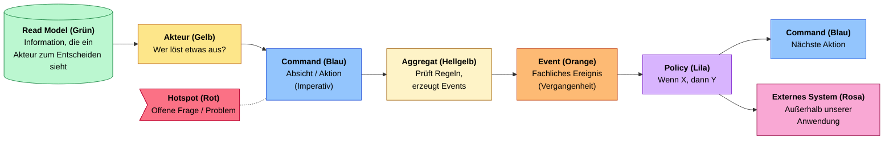
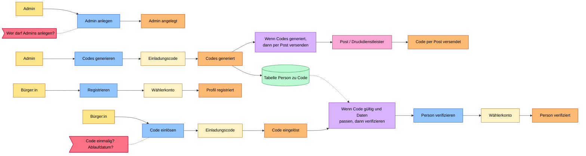
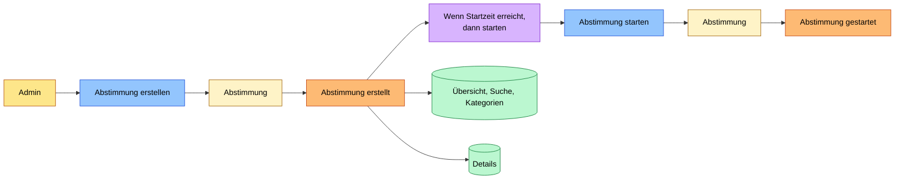
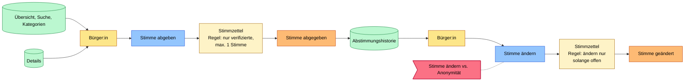
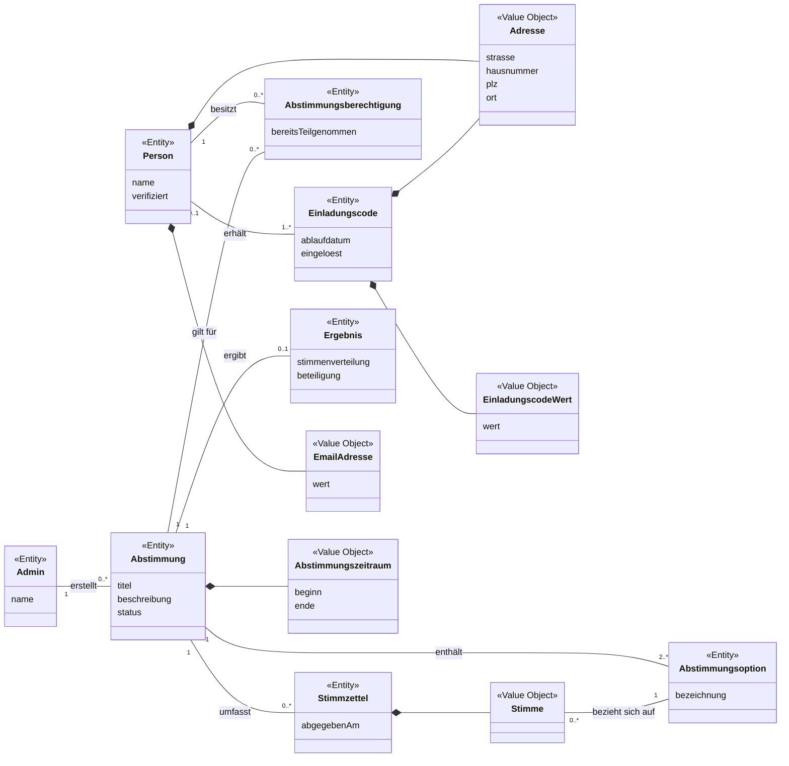
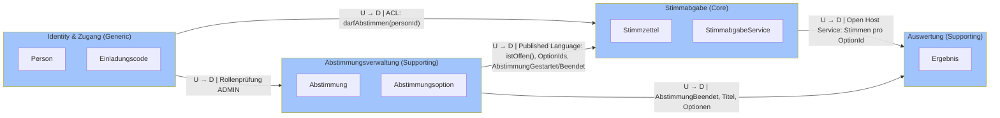
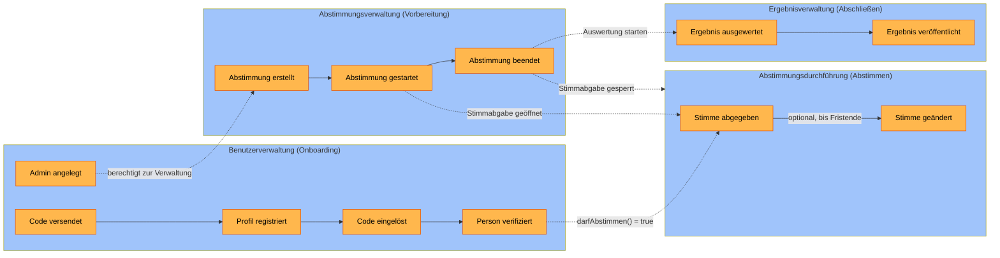

# Übung 3: Systemarchitektzur Ihres Projekts modellieren

## 1. Event Storming: eVote

### Legende

Durchgezogene Pfeile zeigen den Ablauf, gestrichelte Linien Bezüge (z. B. Hotspot zu einem Command).
(Farben mit eingetragen, da @Leo eine Farbsehschwäche hat.)

### Phase 1: Onboarding

### Phase 2: Vorbereiten

### Phase 3: Abstimmen

### Phase 4: Abschließen

### Kompaktübersicht

| 1 Onboarding               | 2 Vorbereiten                                                                                                    | 3 Abstimmen                               | 4 Abschließen                                            |                                                                   |
| -------------------------- | ---------------------------------------------------------------------------------------------------------------- | ----------------------------------------- | -------------------------------------------------------- | ----------------------------------------------------------------- |
| **Akteur** (Gelb)          | Admin, Bürger:in                                                                                                 | Admin                                     | Bürger:in                                                | System (Zeit), Admin                                              |
| **Command** (Blau)         | Admin anlegen, Codes generieren, Registrieren, Code einlösen, Person verifizieren                                | Abstimmung erstellen, Abstimmung starten  | Stimme abgeben, Stimme ändern                            | Abstimmung beenden, Ergebnis auswerten, Ergebnis veröffentlichen  |
| **Aggregat** (Hellgelb)    | Einladungscode, Wählerkonto                                                                                      | Abstimmung                                | Stimmzettel                                              | Abstimmung                                                        |
| **Event** (Orange)         | Admin angelegt, Codes generiert, Code per Post versendet, Profil registriert, Code eingelöst, Person verifiziert | Abstimmung erstellt, Abstimmung gestartet | Stimme abgegeben, Stimme geändert                        | Abstimmung beendet, Ergebnis ausgewertet, Ergebnis veröffentlicht |
| **Policy** (Lila)          | Wenn Codes generiert, dann per Post versenden; Wenn Code gültig und Daten passen, dann verifizieren              | Wenn Startzeit erreicht, dann starten     |                                                          | Wenn Endzeit erreicht, dann beenden; Wenn beendet, dann auswerten |
| **Externes System** (Rosa) | Post / Druckdienstleister                                                                                        |                                           |                                                          |                                                                   |
| **Read Model** (Grün)      | Tabelle Person zu Code                                                                                           |                                           | Übersicht/Suche/Kategorien, Details, Abstimmungshistorie | Ergebnisansicht                                                   |
| **Hotspot** (Rot)          | Wer darf Admins anlegen? Code einmalig? Ablaufdatum?                                                             |                                           | Stimme ändern vs. Anonymität                             | Zwischenergebnisse sichtbar?                                      |

### Geschäftsregeln (Invarianten der Aggregate)

- **Stimmzettel:** Nur verifizierte Personen dürfen abstimmen, maximal eine Stimme pro Abstimmung.
- **Stimmzettel:** Eine Stimme darf nur geändert werden, solange die Abstimmung offen ist.
- **Einladungscode:** Ein Code kann nur einmal eingelöst werden (offen: Ablaufdatum, siehe Hotspot).

## 2. Domänenmodell erstellen (Gesamtsicht)

_Abb. 2: Domänenmodell als Klassendiagramm (fachliche Gesamtsicht, noch ohne Bounded Contexts)_

Die Beziehungen sind hier noch fachlich als Assoziationen gezeichnet: Eine Person erhält einen oder mehrere Einladungscodes; jeder Code wird von höchstens einer Person eingelöst. Ein Admin erstellt beliebig viele Abstimmungen, jede Abstimmung enthält mindestens zwei Abstimmungsoptionen. Für jede Kombination aus Person und Abstimmung gibt es höchstens eine Abstimmungsberechtigung. Eine Abstimmung umfasst beliebig viele Stimmzettel; jeder Stimmzettel enthält genau eine Stimme, die sich auf genau eine Abstimmungsoption bezieht. Aus den Stimmzetteln einer Abstimmung ergibt sich höchstens ein Ergebnis.

Bewusst gibt es **keine** Assoziation zwischen Person und Stimmzettel, damit die Stimmabgabe anonym bleibt. Welche Begriffe zusammengehören (grobe Aggregate-Kandidaten), lässt sich bereits andeuten; verbindlich festgelegt wird es erst in Schritt 4. Wie die Beziehungen später im Code ausgedrückt werden (Objektreferenz, ID oder Token), entscheidet sich ebenfalls dort.

### Zentrale Entitäten

Aus den Events des Event Stormings ergeben sich diese Kernkonzepte:

|Klasse|Typ|Bedeutung|
|---|---|---|
|Person|Entität|Registrierte Bürgerin bzw. registrierter Bürger, die bzw. der nach Verifizierung abstimmen darf|
|Admin|Entität|Benutzer mit administrativen Rechten, legt Abstimmungen an|
|Einladungscode|Entität|Code zur Verifizierung einer Person, wird an eine Adresse verschickt|
|Abstimmung|Entität|Eine angelegte und durchgeführte Abstimmung|
|Abstimmungsoption|Entität|Eine mögliche Antwort bzw. Wahlmöglichkeit|
|Abstimmungsberechtigung|Entität|Dokumentiert, ob eine Person an einer Abstimmung teilnehmen darf bzw. bereits teilgenommen hat|
|Stimmzettel|Entität|Enthält eine abgegebene Stimme, ohne Bezug zur Person|
|Ergebnis|Entität|Aufbereitete Auswertung einer Abstimmung|

### Wertobjekte
- **EmailAdresse**: E-Mail-Adresse einer Person.
- **Adresse**: Postanschrift einer Person bzw. Zieladresse eines Einladungscodes.
- **EinladungscodeWert**: Der eigentliche Code.
- **Abstimmungszeitraum**: Beginn und Ende einer Abstimmung.
- **Stimme**: Die konkrete Auswahl innerhalb einer Abstimmung.

Der Status einer Abstimmung (z. B. Entwurf, aktiv, beendet) wird als einfaches Attribut geführt.

### Besonderheiten

1. **Nur eine Stimme pro Person und Abstimmung** Aus der Policy „Nur verifiziert, max. 1 Stimme“ ergibt sich die zusätzliche Klasse `Abstimmungsberechtigung`. Sie stellt sicher, dass eine verifizierte Person pro Abstimmung nur einmal teilnehmen kann. Dafür wird festgehalten, ob das Stimmrecht bereits genutzt wurde.
    
2. **Anonymität und Änderung einer Stimme** Im Event Storming wurde der Hotspot „Stimme ändern vs. Anonymität“ festgehalten: Das System muss verhindern, dass eine Person mehrfach abstimmt, gleichzeitig darf die abgegebene Stimme nicht ohne Weiteres mit ihrer Identität verknüpft werden. Deshalb wurden `Abstimmungsberechtigung` und `Stimmzettel` getrennt modelliert. Wie eine nachträgliche Änderung einer anonym abgegebenen Stimme technisch ermöglicht wird (z. B. über ein pseudonymes Wählertoken), ist noch eine offene Designentscheidung.
    
3. **Ergebnis** Das Ergebnis wird vollständig aus den Stimmzetteln abgeleitet. In einem späteren Schritt bietet es sich an, es als Read Model umzusetzen.

## 3. Bounded Contexts identifizieren

**Tabelle 1: Identifizierte Bounded Contexts**

|#|Bounded Context|Verantwortung|Klassen aus dem Domänenmodell|Domain Events|Subdomain-Typ|
|---|---|---|---|---|---|
|1|**Identity & Zugang**|Einladungscodes, Registrierung, Verifikation, Login/Logout, Rollen|Person, Einladungscode, Rolle, EmailAdresse, Adresse, EinladungscodeWert|EinladungscodeGeneriert, PersonRegistriert, PersonVerifiziert, AdminAngelegt, PersonAngemeldet|Generic: Standardproblem, das sich mit bewährten Bibliotheken lösen lässt|
|2|**Abstimmungsverwaltung**|Admin erstellt, startet und beendet Abstimmungen; Bürger sehen Übersicht und Details|Abstimmung, Abstimmungsoption, Abstimmungsstatus|AbstimmungErstellt, AbstimmungGestartet, AbstimmungBeendet|Supporting: nötig, aber fachlich einfach|
|3|**Stimmabgabe**|Stimme abgeben und ändern, höchstens eine Stimme pro Bürger, Anonymität|Stimmzettel, Stimme, WaehlerToken, StimmabgabeService|StimmeAbgegeben, StimmeGeaendert|**Core**: Hier liegen Sicherheit, Einmaligkeit und Wahlgeheimnis, also der eigentliche Wert der Anwendung|
|4|**Auswertung**|Stimmen nach Fristende auszählen, Ergebnis und Beteiligung anzeigen|Ergebnis|ErgebnisErmittelt, ErgebnisVeroeffentlicht|Supporting|

**Begründung, warum Stimmabgabe ein eigener Context ist:** Er ist der einzige Context, der Stimmen kennt, und er bekommt nie Klarnamen zu sehen, nur Tokens. Diese Trennung setzt das Wahlgeheimnis architektonisch durch. Deshalb sollte er getrennt von Identity entwickelt werden und eine eigene Datenhaltung haben.

### Context Map
Bounded Contexts und ihre Beziehungen (U = Upstream, D = Downstream)

### Ablauf über die Contexts (aus den Events)
1. **Identity:** EinladungscodeGeneriert → PersonRegistriert → PersonVerifiziert
2. **Abstimmungsverwaltung:** AbstimmungErstellt → AbstimmungGestartet
3. **Stimmabgabe:** StimmeAbgegeben (optional StimmeGeaendert; die Teilnahme ist freiwillig)
4. **Abstimmungsverwaltung:** AbstimmungBeendet
5. **Auswertung:** ErgebnisErmittelt → ErgebnisVeroeffentlicht

Daraus ergibt sich:

- **Code:** Jeder Context wird in Aufgabe 6 ein eigenes Python-Package (`identity/`, `abstimmung/`, `stimmabgabe/`, `auswertung/`).
- **Abhängigkeiten:** Die Pfeile der Context Map sind die einzigen erlaubten Abhängigkeitsrichtungen zwischen den Packages.

### Contexts nach Ablaufphasen
**Tabelle 2: Bounded Contexts mit ausgelösten und empfangenen Events**

|Bounded Context|Verantwortlichkeit|Zugehörige Klassen|Ausgelöste Events|Empfangene Events|
|---|---|---|---|---|
|**Benutzerverwaltung** (Onboarding)|Registrierung, Verifizierung und Verwaltung von Benutzern inkl. Rollen (Bürger/Admin)|`Person`, `Einladungscode`, `Rolle`, `EmailAdresse`, `Adresse`, `EinladungscodeWert`|Code versendet, Profil registriert, Code eingelöst, Person verifiziert, Admin angelegt|–|
|**Abstimmungsverwaltung** (Vorbereitung)|Abstimmungen erstellen, konfigurieren, starten und beenden|`Abstimmung`, `Abstimmungsoption`, `Abstimmungsstatus`|Abstimmung erstellt, Abstimmung gestartet, Abstimmung beendet|Admin angelegt (nur Admins dürfen verwalten)|
|**Abstimmungsdurchführung** (Abstimmen)|Stimmabgabe, Prüfung der Teilnahmeberechtigung und Änderung von Stimmen|`Stimmzettel`, `Stimme`, `WaehlerToken`, `StimmabgabeService`|Stimme abgegeben, Stimme geändert|Person verifiziert, Abstimmung gestartet, Abstimmung beendet|
|**Ergebnisverwaltung** (Abschließen)|Stimmen auswerten und Ergebnisse veröffentlichen|`Ergebnis`|Ergebnis ausgewertet, Ergebnis veröffentlicht|Abstimmung beendet|

Event-Fluss zwischen den Bounded Contexts (orange: Domain Events, gestrichelt: Event wird von einem anderen Context empfangen)

