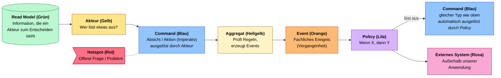
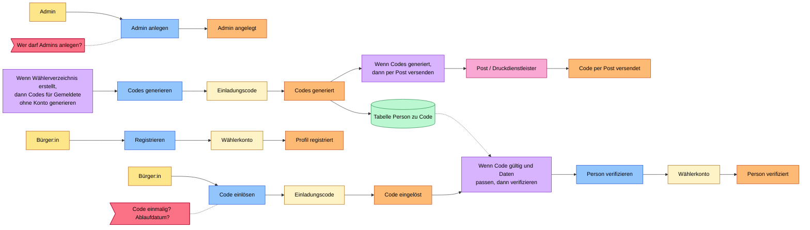
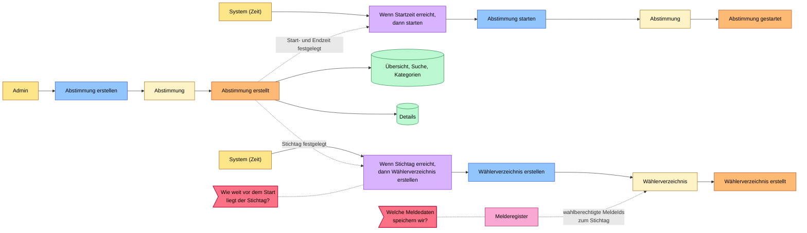
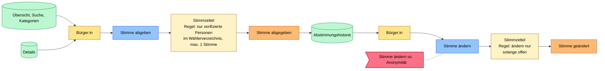
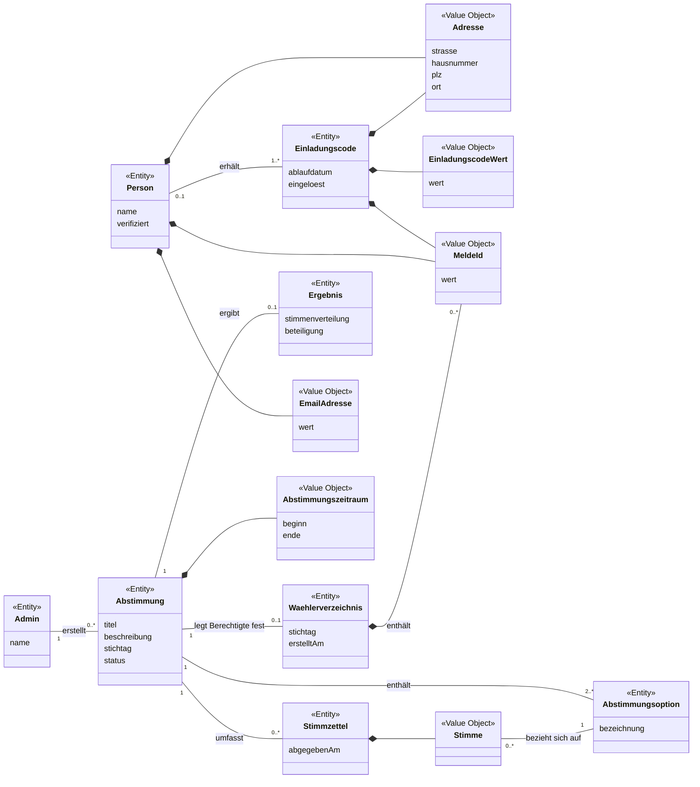
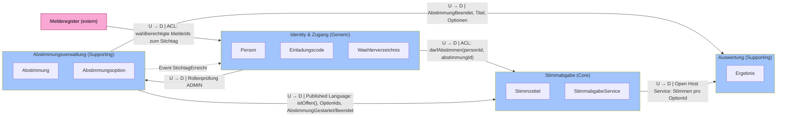
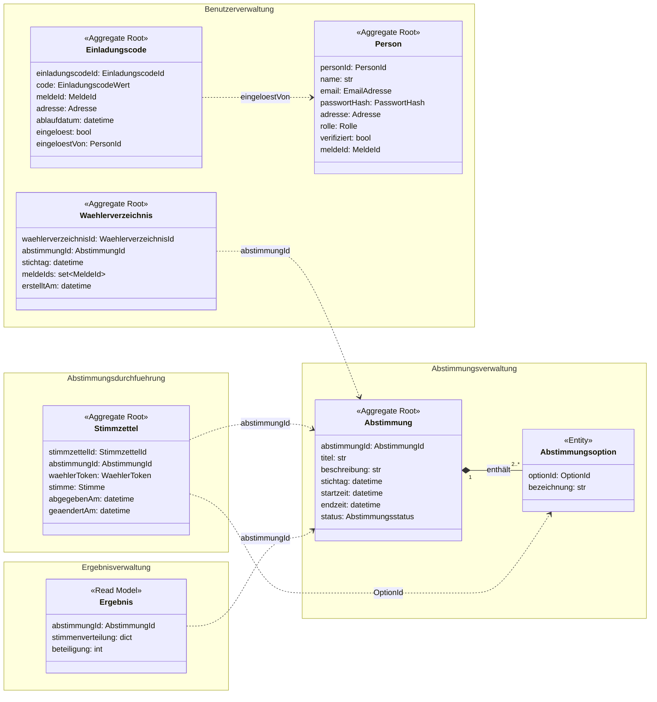

# Übung 3: Systemarchitektur Ihres Projekts modellieren

## 1. Event Storming: eVote

### Legende



Durchgezogene Pfeile zeigen den Ablauf, gestrichelte Linien Bezüge (z. B. Hotspot zu einem Command).

**Grundidee:** Verifizierung und Wahlberechtigung sind getrennt. Die **Verifizierung** passiert einmalig per Einladungscode und verknüpft ein Konto dauerhaft mit einer `MeldeId`. Die **Wahlberechtigung** wird für jede Abstimmung neu aus dem Melderegister ermittelt (Wählerverzeichnis zum Stichtag). Wer wegzieht, muss nichts tun: Die Person steht beim nächsten Stichtag einfach nicht mehr im Wählerverzeichnis. Wer innerhalb des Gebiets umzieht, behält seine `MeldeId`.
(Farben mit eingetragen, da @Leo eine Farbsehschwäche hat.)


### Phase 1: Onboarding



Einladungscodes werden nicht von Hand erzeugt. Sobald zu einer Abstimmung das Wählerverzeichnis erstellt ist (Phase 2), bekommt jede wahlberechtigte Person, die noch kein verifiziertes Konto und keinen gültigen Code hat, automatisch einen Code per Post. So werden alle Gemeldeten erreicht, auch neu Zugezogene.

### Phase 2: Vorbereiten



Start und Ende einer Abstimmung laufen automatisch: Der Admin legt beim Erstellen Stichtag, Start- und Endzeit fest. Zum Stichtag ruft das System die wahlberechtigten `MeldeId`s aus dem Melderegister ab und erstellt daraus das Wählerverzeichnis dieser Abstimmung. Das System (Zeit) startet die Abstimmung zur Startzeit (Phase 2) und beendet sie zur Endzeit (Phase 4). Der Admin startet oder beendet eine Abstimmung nicht manuell. Der Stichtag liegt so weit vor dem Start, dass neue Einladungscodes noch rechtzeitig per Post ankommen.

### Phase 3: Abstimmen



### Phase 4: Abschließen

```mermaid
flowchart LR
  sys["System (Zeit)"]:::actor --> p_end["Wenn Endzeit erreicht,<br>dann beenden"]:::policy --> c_end["Abstimmung beenden"]:::command --> ag_ab3["Abstimmung"]:::aggregate --> e_ended["Abstimmung beendet"]:::event
  e_ended --> p_eval["Wenn beendet,<br>dann auswerten"]:::policy --> c_eval["Ergebnis auswerten"]:::command --> ag_ab4["Abstimmung"]:::aggregate --> e_eval["Ergebnis ausgewertet"]:::event

  e_eval --> ad4["Admin"]:::actor --> c_pub["Ergebnis veröffentlichen"]:::command --> ag_ab5["Abstimmung"]:::aggregate --> e_pub["Ergebnis veröffentlicht"]:::event
  e_pub --> rm_res[("Ergebnisansicht")]:::readmodel
  h_zw>"Zwischenergebnisse sichtbar?"]:::hotspot -.- rm_res

  classDef actor fill:#fde68a,stroke:#b45309,color:#000
  classDef command fill:#93c5fd,stroke:#1d4ed8,color:#000
  classDef aggregate fill:#fef3c7,stroke:#a16207,color:#000
  classDef event fill:#fdba74,stroke:#c2410c,color:#000
  classDef policy fill:#d8b4fe,stroke:#7e22ce,color:#000
  classDef readmodel fill:#bbf7d0,stroke:#15803d,color:#000
  classDef hotspot fill:#fb7185,stroke:#be123c,color:#000
```



### Kompaktübersicht

|                            | 1 Onboarding | 2 Vorbereiten | 3 Abstimmen | 4 Abschließen |
| -------------------------- | ------------ | ------------- | ----------- | ------------- |
| **Akteur** (Gelb)          | Admin, Bürger:in | Admin, System (Zeit) | Bürger:in | System (Zeit), Admin |
| **Command** (Blau)         | Admin anlegen, Codes generieren, Registrieren, Code einlösen, Person verifizieren | Abstimmung erstellen, Wählerverzeichnis erstellen, Abstimmung starten | Stimme abgeben, Stimme ändern | Abstimmung beenden, Ergebnis auswerten, Ergebnis veröffentlichen |
| **Aggregat** (Hellgelb)    | Einladungscode, Wählerkonto | Abstimmung, Wählerverzeichnis | Stimmzettel | Abstimmung |
| **Event** (Orange)         | Admin angelegt, Codes generiert, Code per Post versendet, Profil registriert, Code eingelöst, Person verifiziert | Abstimmung erstellt, Wählerverzeichnis erstellt, Abstimmung gestartet | Stimme abgegeben, Stimme geändert | Abstimmung beendet, Ergebnis ausgewertet, Ergebnis veröffentlicht |
| **Policy** (Lila)          | Wenn Wählerverzeichnis erstellt, dann Codes für Gemeldete ohne Konto generieren; Wenn Codes generiert, dann per Post versenden; Wenn Code gültig und Daten passen, dann verifizieren | Wenn Stichtag erreicht, dann Wählerverzeichnis erstellen; Wenn Startzeit erreicht, dann starten | | Wenn Endzeit erreicht, dann beenden; Wenn beendet, dann auswerten |
| **Externes System** (Rosa) | Post / Druckdienstleister | Melderegister | | |
| **Read Model** (Grün)      | Tabelle Person zu Code | Übersicht/Suche/Kategorien, Details | Übersicht/Suche/Kategorien, Details, Abstimmungshistorie | Ergebnisansicht |
| **Hotspot** (Rot)          | Wer darf Admins anlegen? Code einmalig? Ablaufdatum? | Welche Meldedaten speichern wir? Wie weit vor dem Start liegt der Stichtag? | Stimme ändern vs. Anonymität | Zwischenergebnisse sichtbar? |

### Geschäftsregeln (Invarianten der Aggregate)

- **Stimmzettel:** Nur verifizierte Personen, deren `MeldeId` im Wählerverzeichnis der Abstimmung steht, dürfen abstimmen, maximal eine Stimme pro Abstimmung.
- **Stimmzettel:** Eine Stimme darf nur geändert werden, solange die Abstimmung offen ist.
- **Einladungscode:** Ein Code ist über die `MeldeId` an genau einen Meldeeintrag gebunden und kann nur einmal eingelöst werden (offen: Ablaufdatum, siehe Hotspot).
- **Meldeeintrag:** Zu einem Meldeeintrag (`MeldeId`) gibt es höchstens ein verifiziertes Konto.
- **Abstimmung:** Start und Ende erfolgen automatisch zur festgelegten Start- bzw. Endzeit, nicht manuell durch den Admin. Der Stichtag liegt vor der Startzeit.
- **Wählerverzeichnis:** Pro Abstimmung gibt es genau ein Wählerverzeichnis. Es wird zum Stichtag aus dem Melderegister erstellt und danach nicht mehr verändert.
- **Verifizierung vs. Wahlberechtigung:** Die Verifizierung erfolgt einmalig. Nach einem Umzug ist keine erneute Verifizierung nötig; die Wahlberechtigung ergibt sich bei jeder Abstimmung neu aus dem Wählerverzeichnis.


## 2. Domänenmodell erstellen (Gesamtsicht)



_Abb. 2: Domänenmodell als Klassendiagramm (fachliche Gesamtsicht, noch ohne Bounded Contexts)_

Die Beziehungen sind hier noch fachlich als Assoziationen gezeichnet: Eine Person erhält einen oder mehrere Einladungscodes; jeder Code wird von höchstens einer Person eingelöst. Jeder Einladungscode ist über eine eindeutige `MeldeId` an genau einen Meldeeintrag gebunden und wird an dessen Adresse verschickt. Wohnen mehrere Personen unter derselben Adresse, erhält jede einen eigenen Code mit eigener `MeldeId`. Ein Admin erstellt beliebig viele Abstimmungen, jede Abstimmung enthält mindestens zwei Abstimmungsoptionen. Zu jeder Abstimmung gibt es höchstens ein Wählerverzeichnis; es enthält die `MeldeId`s aller Personen, die zum Stichtag laut Melderegister wahlberechtigt sind. Eine Person darf abstimmen, wenn ihr Konto verifiziert ist und ihre `MeldeId` im Wählerverzeichnis steht. Eine Abstimmung umfasst beliebig viele Stimmzettel; jeder Stimmzettel enthält genau eine Stimme, die sich auf genau eine Abstimmungsoption bezieht. Aus den Stimmzetteln einer Abstimmung ergibt sich höchstens ein Ergebnis.

Bewusst gibt es **keine** Assoziation zwischen Person und Stimmzettel, damit die Stimmabgabe anonym bleibt. Welche Begriffe zusammengehören (grobe Aggregate-Kandidaten), lässt sich bereits andeuten; verbindlich festgelegt wird es erst in Schritt 4. Wie die Beziehungen später im Code ausgedrückt werden (Objektreferenz, ID oder Token), entscheidet sich ebenfalls dort.

### Zentrale Entitäten

Aus den Events des Event Stormings ergeben sich diese Kernkonzepte:

|Klasse|Typ|Bedeutung|
|---|---|---|
|Person|Entität|Registrierte Bürgerin bzw. registrierter Bürger, die bzw. der nach Verifizierung abstimmen darf|
|Admin|Entität|Benutzer mit administrativen Rechten, legt Abstimmungen an|
|Einladungscode|Entität|Code zur Verifizierung einer bestimmten Person, über die `MeldeId` an ihren Meldeeintrag gebunden und an ihre Meldeadresse verschickt|
|Abstimmung|Entität|Eine angelegte und durchgeführte Abstimmung|
|Abstimmungsoption|Entität|Eine mögliche Antwort bzw. Wahlmöglichkeit|
|Wählerverzeichnis|Entität|Liste der zum Stichtag wahlberechtigten `MeldeId`s für genau eine Abstimmung, erstellt aus dem Melderegister|
|Stimmzettel|Entität|Enthält eine abgegebene Stimme, ohne Bezug zur Person|
|Ergebnis|Entität|Aufbereitete Auswertung einer Abstimmung|

### Wertobjekte
- **EmailAdresse**: E-Mail-Adresse einer Person.
- **Adresse**: Postanschrift einer Person. Beim Einladungscode ist sie nur die Versandadresse; zugeordnet wird der Code über die `MeldeId`, nicht über die Adresse.
- **MeldeId**: Eindeutige Kennung eines Meldeeintrags, wird aus dem Melderegister übernommen. Sie bleibt bei einem Umzug innerhalb des Gebiets gleich.
- **EinladungscodeWert**: Der eigentliche Code.
- **Abstimmungszeitraum**: Beginn und Ende einer Abstimmung.
- **Stimme**: Die konkrete Auswahl innerhalb einer Abstimmung.

Der Status einer Abstimmung (z. B. Entwurf, aktiv, beendet) wird als einfaches Attribut geführt.

### Besonderheiten

1. **Wer darf bei welcher Abstimmung abstimmen?** Aus der Regel „nur verifizierte Personen im Wählerverzeichnis, max. 1 Stimme“ ergibt sich die Klasse `Waehlerverzeichnis`. Sie legt pro Abstimmung fest, wer teilnehmen darf. Dass eine Person höchstens einmal abstimmt, wird nicht hier festgehalten, sondern über den Stimmzettel gesichert (siehe Punkt 2).
    
2. **Anonymität und Änderung einer Stimme** Im Event Storming wurde der Hotspot „Stimme ändern vs. Anonymität“ festgehalten: Das System muss verhindern, dass eine Person mehrfach abstimmt, gleichzeitig darf die abgegebene Stimme nicht ohne Weiteres mit ihrer Identität verknüpft werden. Deshalb wurden `Waehlerverzeichnis` und `Stimmzettel` getrennt modelliert. Wie eine nachträgliche Änderung einer anonym abgegebenen Stimme technisch ermöglicht wird (z. B. über ein pseudonymes Wählertoken), ist noch eine offene Designentscheidung.
    
3. **Ergebnis** Das Ergebnis wird vollständig aus den Stimmzetteln abgeleitet. In einem späteren Schritt bietet es sich an, es als Read Model umzusetzen.

4. **Ein Code pro Person, nicht pro Haushalt** Wäre der Einladungscode nur an die Adresse gebunden, könnte jede Person im Haushalt jeden Code dieser Adresse einlösen. Ein Abgleich über Name und Adresse wäre fehleranfällig (gleiche Namen im Haushalt, Schreibweisen, Namensänderungen). Deshalb wird der Code an die eindeutige `MeldeId` aus dem Melderegister gebunden (entspricht dem Read Model „Tabelle Person zu Code“ aus dem Event Storming). Bei der Verifizierung übernimmt die Person die `MeldeId` des Codes; zu jeder `MeldeId` gibt es höchstens ein verifiziertes Konto. Das funktioniert auch, wenn ein verlorener Code neu ausgestellt wird.
    
    **Bewusste Einschränkung:** Wer den Brief einer anderen Person an sich nimmt, kann deren Code einlösen. Dieses Restrisiko besteht bei der Briefwahl genauso.

5. **Umzug ohne erneute Verifizierung** Die Verifizierung verknüpft ein Konto einmalig mit einer `MeldeId`. Ob diese `MeldeId` bei einer Abstimmung wahlberechtigt ist, entscheidet das Wählerverzeichnis, das zum Stichtag aus dem Melderegister erstellt wird. Zieht eine Person weg, fehlt ihre `MeldeId` beim nächsten Stichtag im Verzeichnis, und sie kann an dieser Abstimmung nicht teilnehmen, ohne dass jemand etwas tun muss. Zieht sie später zurück, steht sie wieder im Verzeichnis und kann ihr bestehendes Konto weiter nutzen. Wer nach dem Stichtag wegzieht, darf an der laufenden Abstimmung noch teilnehmen, wie bei echten Wahlen auch.


## 3. Bounded Contexts identifizieren

**Tabelle 1: Identifizierte Bounded Contexts**

|#|Bounded Context|Verantwortung|Klassen aus dem Domänenmodell|Domain Events|Subdomain-Typ|
|---|---|---|---|---|---|
|1|**Identity & Zugang**|Einladungscodes, Registrierung, Verifikation, Login/Logout, Rollen, Wählerverzeichnis pro Abstimmung aus dem Melderegister|Person, Einladungscode, Waehlerverzeichnis, Rolle, EmailAdresse, Adresse, EinladungscodeWert, MeldeId|EinladungscodeGeneriert, PersonRegistriert, PersonVerifiziert, AdminAngelegt, PersonAngemeldet, WaehlerverzeichnisErstellt|Generic: Standardproblem, das sich mit bewährten Bibliotheken lösen lässt|
|2|**Abstimmungsverwaltung**|Admin erstellt Abstimmungen mit Start- und Endzeit; das System startet und beendet sie automatisch; Bürger sehen Übersicht und Details|Abstimmung, Abstimmungsoption, Abstimmungsstatus|AbstimmungErstellt, StichtagErreicht, AbstimmungGestartet, AbstimmungBeendet|Supporting: nötig, aber fachlich einfach|
|3|**Stimmabgabe**|Stimme abgeben und ändern, höchstens eine Stimme pro Bürger, Anonymität|Stimmzettel, Stimme, WaehlerToken, StimmabgabeService|StimmeAbgegeben, StimmeGeaendert|**Core**: Hier liegen Sicherheit, Einmaligkeit und Wahlgeheimnis, also der eigentliche Wert der Anwendung|
|4|**Auswertung**|Stimmen nach Fristende auszählen, Ergebnis und Beteiligung anzeigen|Ergebnis|ErgebnisErmittelt, ErgebnisVeroeffentlicht|Supporting|

**Begründung, warum Stimmabgabe ein eigener Context ist:** Er ist der einzige Context, der Stimmen kennt, und er bekommt nie Klarnamen zu sehen, nur Tokens. Diese Trennung setzt das Wahlgeheimnis architektonisch durch. Deshalb sollte er getrennt von Identity entwickelt werden und eine eigene Datenhaltung haben.

### Context Map
Bounded Contexts und ihre Beziehungen (U = Upstream, D = Downstream)


Das Melderegister ist ein externes System. Die Benutzerverwaltung spricht es nur über eine Anti-Corruption Layer an (Interface `Melderegister`, Schritt 5), damit dessen Datenformat nicht in unser Modell durchschlägt.

Zwischen Identity und Abstimmungsverwaltung bestehen damit Beziehungen in beide Richtungen: Die Abstimmungsverwaltung nutzt die Rollenprüfung, die Benutzerverwaltung reagiert auf das Event `StichtagErreicht`. Damit daraus keine zyklische Abhängigkeit zwischen den Packages wird, liegen die Event-Klassen in einem gemeinsamen Modul `shared/events`, das beide Contexts kennen, ohne einander direkt zu importieren.

### Ablauf über die Contexts (aus den Events)
1. **Abstimmungsverwaltung:** AbstimmungErstellt (mit Stichtag, Start- und Endzeit) → StichtagErreicht
2. **Identity:** WaehlerverzeichnisErstellt → EinladungscodeGeneriert (nur für Gemeldete ohne Konto) → PersonRegistriert → PersonVerifiziert
3. **Abstimmungsverwaltung:** AbstimmungGestartet
4. **Stimmabgabe:** StimmeAbgegeben (optional StimmeGeaendert; die Teilnahme ist freiwillig)
5. **Abstimmungsverwaltung:** AbstimmungBeendet
6. **Auswertung:** ErgebnisErmittelt → ErgebnisVeroeffentlicht

Bei der allerersten Abstimmung hat noch niemand ein Konto. Das erste Wählerverzeichnis erzeugt deshalb für alle Wahlberechtigten einen Einladungscode.

Daraus ergibt sich:

- **Code:** Jeder Context wird in Aufgabe 6 ein eigenes Python-Package (`identity/`, `abstimmung/`, `stimmabgabe/`, `auswertung/`).
- **Abhängigkeiten:** Die Pfeile der Context Map sind die einzigen erlaubten Abhängigkeitsrichtungen zwischen den Packages.

### Contexts nach Ablaufphasen
**Tabelle 2: Bounded Contexts mit ausgelösten und empfangenen Events**

|Bounded Context|Verantwortlichkeit|Zugehörige Klassen|Ausgelöste Events|Empfangene Events|
|---|---|---|---|---|
|**Benutzerverwaltung** (Onboarding)|Registrierung, Verifizierung und Verwaltung von Benutzern inkl. Rollen (Bürger/Admin); Wählerverzeichnis pro Abstimmung aus dem Melderegister|`Person`, `Einladungscode`, `Waehlerverzeichnis`, `Rolle`, `EmailAdresse`, `Adresse`, `EinladungscodeWert`, `MeldeId`|Wählerverzeichnis erstellt, Code versendet, Profil registriert, Code eingelöst, Person verifiziert, Admin angelegt|Stichtag erreicht|
|**Abstimmungsverwaltung** (Vorbereitung)|Abstimmungen erstellen und konfigurieren (Admin); zur Start- bzw. Endzeit automatisch starten und beenden (System)|`Abstimmung`, `Abstimmungsoption`, `Abstimmungsstatus`|Abstimmung erstellt, Stichtag erreicht, Abstimmung gestartet, Abstimmung beendet|Admin angelegt (nur Admins dürfen verwalten)|
|**Abstimmungsdurchführung** (Abstimmen)|Stimmabgabe, Prüfung der Teilnahmeberechtigung und Änderung von Stimmen|`Stimmzettel`, `Stimme`, `WaehlerToken`, `StimmabgabeService`|Stimme abgegeben, Stimme geändert|Person verifiziert, Wählerverzeichnis erstellt, Abstimmung gestartet, Abstimmung beendet|
|**Ergebnisverwaltung** (Abschließen)|Stimmen auswerten und Ergebnisse veröffentlichen|`Ergebnis`|Ergebnis ausgewertet, Ergebnis veröffentlicht|Abstimmung beendet|

Event-Fluss zwischen den Bounded Contexts (orange: Domain Events, gestrichelt: Event wird von einem anderen Context empfangen)

```mermaid
flowchart LR
    subgraph BV["Benutzerverwaltung (Onboarding)"]
        BV6["Wählerverzeichnis erstellt"] -- "nur Gemeldete ohne Konto" --> BV1["Code versendet"] --> BV2["Profil registriert"] --> BV3["Code eingelöst"] --> BV4["Person verifiziert"]
        BV5["Admin angelegt"]
    end

    subgraph AV["Abstimmungsverwaltung (Vorbereitung)"]
        AV1["Abstimmung erstellt"] --> AV0["Stichtag erreicht"] --> AV2["Abstimmung gestartet"] --> AV3["Abstimmung beendet"]
    end

    subgraph AD["Abstimmungsdurchführung (Abstimmen)"]
        AD1["Stimme abgegeben"] -- "optional, bis Fristende" --> AD2["Stimme geändert"]
    end

    subgraph EV["Ergebnisverwaltung (Abschließen)"]
        EV1["Ergebnis ausgewertet"] --> EV2["Ergebnis veröffentlicht"]
    end

    %% Events, die ein anderer Context empfängt
    BV5 -. "berechtigt zur Verwaltung" .-> AV1
    AV0 -. "Wählerverzeichnis erstellen" .-> BV6
    BV4 -. "verifiziert" .-> AD1
    BV6 -. "MeldeId im Verzeichnis" .-> AD1
    AV2 -. "Stimmabgabe geöffnet" .-> AD1
    AV3 -. "Stimmabgabe gesperrt" .-> AD
    AV3 -. "Auswertung starten" .-> EV1

    classDef event fill:#ffb74d,stroke:#e65100,color:#000
    class BV1,BV2,BV3,BV4,BV5,BV6,AV0,AV1,AV2,AV3,AD1,AD2,EV1,EV2 event
    style BV fill:#a0c4fb
    style AV fill:#a0c4fb
    style AD fill:#a0c4fb
    style EV fill:#a0c4fb
```


## 4. Entitäten und Aggregates definieren (Detail pro Context)

Grundlage sind unser finales Klassendiagramm (Aufgabe 2) und die Bounded-Context-Tabelle (Aufgabe 3).

Ein Aggregate ist eine Gruppe zusammengehöriger Objekte, die gemeinsam gespeichert wird und fachliche Regeln einhält. Für den Entwurf gelten vier Grundregeln:

- Jedes Aggregate hat genau eine Aggregate Root. Nur sie wird von außen angesprochen.
- Die Aggregate Root schützt die Invarianten. Fachregeln stehen deshalb in der Root und nicht in einem Service.
- Aggregates werden als Ganzes gespeichert und geladen (ein Repository pro Aggregate).
- Andere Aggregates werden nur über ihre ID referenziert, nicht über ein Objekt.

Für eVote kommen zwei Festlegungen dazu:

- Alle IDs sind Value Objects über einer UUID (`PersonId`, `AbstimmungId`, `OptionId`, `StimmzettelId`, `EinladungscodeId`, `WaehlerverzeichnisId`). Ausnahme ist die `MeldeId`, die aus dem Melderegister übernommen wird.
- Pro Transaktion wird genau ein Aggregate geändert.

Aggregates pro Bounded Context (gestrichelt: Verweise ausschließlich per ID, durchgezogen: Teil desselben Aggregates)




**Unterschied zu Abbildung 2:** Dort hat die Abstimmung eine direkte Beziehung zu ihren Stimmzetteln und zu ihrem Wählerverzeichnis. Hier trägt der Stimmzettel nur die `abstimmungId` und statt der `personId` ein pseudonymes `WaehlerToken`. Dadurch lässt sich jedes Aggregate unabhängig laden, speichern und testen, und kein Aggregate verbindet eine Stimme mit einem Klarnamen. Das `Waehlerverzeichnis` aus Abbildung 2 ist ein eigenes Aggregate in der Benutzerverwaltung. Es verweist nur über die `abstimmungId` auf die Abstimmung und enthält `MeldeId`s, also keine Klarnamen. Ob eine Person abstimmen darf, ergibt sich aus `Person.darfAbstimmen()` (verifizierter Bürger) **und** `Waehlerverzeichnis.enthaelt(meldeId)`. Dass sie höchstens einmal abstimmt, sichert die Eindeutigkeit von `(abstimmungId, waehlerToken)` auf dem Stimmzettel.

### Aggregates

|Aggregate|Attribute|Methoden|Invarianten|
|---|---|---|---|
|**Person**<br>Aggregate Root<br>Context: Benutzerverwaltung|**personId**: PersonId<br>name: str<br>email: EmailAdresse<br>passwortHash: PasswortHash<br>adresse: Adresse<br>rolle: Rolle (BUERGER, ADMIN)<br>verifiziert: bool<br>meldeId: MeldeId \| None|`registrieren(name, email, passwort, adresse)` _[Factory]_<br>`alsAdminAnlegen(name, email, passwort)` _[Factory]_<br>`verifizieren(meldeId)`<br>`passwortPruefen(klartext)`<br>`darfAbstimmen()` _(Grundvoraussetzung: verifizierter Bürger; die Prüfung pro Abstimmung erfolgt zusätzlich über das Wählerverzeichnis)_|Name und E-Mail sind nicht leer<br>Ein Admin kann nie abstimmen: `darfAbstimmen()` liefert für ADMIN immer `False`<br>Eine nicht verifizierte Person kann nicht abstimmen<br>Ein verifizierter Bürger hat genau eine `MeldeId`, sie ändert sich danach nicht mehr<br>Das Passwort wird nie im Klartext gehalten|
|**Einladungscode**<br>Aggregate Root<br>Context: Benutzerverwaltung|**einladungscodeId**: EinladungscodeId<br>code: EinladungscodeWert<br>meldeId: MeldeId<br>adresse: Adresse<br>ablaufdatum: datetime<br>eingeloest: bool<br>_eingeloestVon_: PersonId \| None|`generieren(meldeId, adresse, ablaufdatum)` _[Factory]_<br>`einloesen(personId, jetzt)`<br>`istAbgelaufen(jetzt)`|Jeder Code gehört zu genau einer `MeldeId`<br>Ein Code wird nur einmal eingelöst<br>Ein abgelaufener Code kann nicht eingelöst werden<br>`eingeloestVon` ist genau dann gesetzt, wenn `eingeloest` gilt|
|**Abstimmung**<br>Aggregate Root<br>Context: Abstimmungsverwaltung|**abstimmungId**: AbstimmungId<br>titel: str<br>beschreibung: str<br>stichtag: datetime<br>startzeit: datetime<br>endzeit: datetime<br>status: Abstimmungsstatus<br>optionen: list[Abstimmungsoption]|`erstellen(titel, beschreibung, optionen, stichtag, startzeit, endzeit)` _[Factory]_<br>`bearbeiten(titel, beschreibung, optionen)`<br>`starten(jetzt)`<br>`beenden(jetzt)`<br>`istOffen(jetzt)`|`stichtag` liegt vor `startzeit`, `endzeit` liegt nach `startzeit`<br>Mindestens 2 Optionen, keine Bezeichnung doppelt<br>Statuswechsel nur ENTWURF → AKTIV → BEENDET, nie zurück<br>`starten(jetzt)` nur, wenn `jetzt` ≥ `startzeit`; `beenden(jetzt)` nur, wenn `jetzt` ≥ `endzeit`<br>`istOffen(jetzt)` gilt nur bei Status AKTIV und `startzeit` ≤ `jetzt` < `endzeit`<br>Ab AKTIV sind Titel, Beschreibung und Optionen unveränderlich|
|**Waehlerverzeichnis**<br>Aggregate Root<br>Context: Benutzerverwaltung|**waehlerverzeichnisId**: WaehlerverzeichnisId<br>_abstimmungId_: AbstimmungId<br>stichtag: datetime<br>meldeIds: set[MeldeId]<br>erstelltAm: datetime|`erstellen(abstimmungId, stichtag, meldeIds, jetzt)` _[Factory]_<br>`enthaelt(meldeId): bool`|Pro Abstimmung genau ein Wählerverzeichnis<br>Wird erst ab dem Stichtag erstellt (`jetzt` ≥ `stichtag`)<br>Nach dem Erstellen unveränderlich, keine `MeldeId` wird hinzugefügt oder entfernt<br>Enthält nur `MeldeId`s, keine Namen oder Adressen|
|**Abstimmungsoption**<br>Entity im Aggregate Abstimmung<br>Context: Abstimmungsverwaltung|**optionId**: OptionId<br>bezeichnung: str|– (wird nur über `Abstimmung` angelegt und geändert)|Bezeichnung ist nicht leer|
|**Stimmzettel**<br>Aggregate Root<br>Context: Abstimmungsdurchführung|**stimmzettelId**: StimmzettelId<br>_abstimmungId_: AbstimmungId<br>waehlerToken: WaehlerToken<br>stimme: Stimme<br>abgegebenAm: datetime<br>geaendertAm: datetime \| None|`abgeben(abstimmungId, waehlerToken, stimme)` _[Factory]_<br>`aendern(stimme, jetzt)`|Die Stimme zeigt auf genau eine OptionId<br>`geaendertAm` liegt nicht vor `abgegebenAm`<br>Der Stimmzettel enthält keine PersonId, nur das Token|

**Warum `Abstimmungsoption` eine Entity und kein Value Object ist:** Stimmzettel verweisen dauerhaft über die `OptionId` auf die Option. Die Option braucht deshalb eine stabile Identität. Der Zugriff erfolgt nur über `Abstimmung`, ein eigenes Repository gibt es nicht.

**Warum der `Einladungscode` eine `MeldeId` hat:** Die Adresse allein bestimmt nur den Haushalt, und ein Abgleich über den Namen ist fehleranfällig. Die `MeldeId` ordnet jeden Code eindeutig einem Meldeeintrag zu. Der Name der Person wird nur für das Anschreiben an den Druckdienstleister übergeben und im Code nicht gespeichert.

**Warum das `Waehlerverzeichnis` in der Benutzerverwaltung liegt:** Es enthält `MeldeId`s, und diese dürfen den Context Abstimmungsdurchführung nie erreichen. Die Benutzerverwaltung kennt die `MeldeId` ohnehin und beantwortet nach außen nur die Frage „darf diese Person bei dieser Abstimmung abstimmen?“ mit ja oder nein.

**`alsAdminAnlegen()`** ist im Klassendiagramm aus Aufgabe 2 noch nicht enthalten. Ohne diese Methode gibt es keinen Auslöser für das Event „Admin angelegt“. Die Methode ist im Diagramm zu ergänzen.

### Value Objects

|Value Object|Attribute|Regel|
|---|---|---|
|`PersonId`, `EinladungscodeId`, `AbstimmungId`, `OptionId`, `StimmzettelId`, `WaehlerverzeichnisId`|wert: UUID|Wird beim Anlegen des Aggregates erzeugt. Unveränderlich (`frozen dataclass`).|
|`EmailAdresse`|wert: str|Gültiges E-Mail-Format, wird klein geschrieben gespeichert. Unveränderlich.|
|`PasswortHash`|wert: str|Enthält nur den Hash, nie das Klartextpasswort. Unveränderlich.|
|`Adresse`|strasse: str, hausnummer: str, plz: str, ort: str|Kein Feld ist leer, die PLZ hat 5 Ziffern. Unveränderlich.|
|`EinladungscodeWert`|wert: str|Feste Länge, zufällig erzeugt, nicht leer. Unveränderlich.|
|`MeldeId`|wert: str|Eindeutige Kennung eines Meldeeintrags, wird aus dem Melderegister übernommen. Unveränderlich.|
|`Rolle`|Enum: BUERGER, ADMIN|–|
|`Abstimmungsstatus`|Enum: ENTWURF, AKTIV, BEENDET|Wechsel nur vorwärts.|
|`WaehlerToken`|wert: str|Pseudonym, lässt sich ohne Zusatzwissen nicht auf eine Person zurückführen. Unveränderlich.|
|`Stimme`|ausgewaehlteOption: OptionId|Verweist auf genau eine Option. Unveränderlich; eine Änderung ersetzt das ganze Objekt.|

### Read Model `Ergebnis` (Context: Ergebnisverwaltung)

`Ergebnis` ist kein Aggregate, weil es keine eigenen Regeln schützt. Es wird einmalig aus den Stimmzetteln berechnet und danach nur gelesen.

|Attribut|Typ|Beschreibung|
|---|---|---|
|_abstimmungId_|AbstimmungId|ID der ausgewerteten Abstimmung|
|stimmenverteilung|dict[OptionId, int]|Anzahl Stimmen pro Option|
|beteiligung|int|Anzahl abgegebener Stimmzettel|
|ermitteltAm|datetime|Zeitpunkt der Auswertung|

**Entstehung:** Nach dem Event „Abstimmung beendet“ zählt der `AuswertungsService` (Schritt 5) die Stimmzettel aus, erzeugt das `Ergebnis` und löst „Ergebnis ausgewertet“ und „Ergebnis veröffentlicht“ aus. Ein Ergebnis entsteht erst nach `BEENDET` und wird danach nicht mehr geändert.

### Anmerkungen

- Regeln, die mehrere Aggregates betreffen, kann eine einzelne Aggregate Root nicht allein sichern. Sie werden in Schritt 5 in Services behandelt:
    - **Eindeutigkeit der E-Mail-Adresse:** betrifft alle `Person`-Aggregates. Prüfung im `RegistrierungsService`, zusätzlich `UNIQUE(email)` in der Datenbank.
    - **Höchstens ein verifiziertes Konto pro Meldeeintrag:** Eine `MeldeId` darf nur bei einer Person eingetragen sein. Das betrifft alle `Person`-Aggregates und den `Einladungscode`, also prüft es der `RegistrierungsService`, zusätzlich `UNIQUE(melde_id)` in der Datenbank.
    - **Höchstens ein Stimmzettel pro Bürger und Abstimmung:** Prüfung im `StimmabgabeService`, zusätzlich `UNIQUE(abstimmung_id, waehler_token)` in der Datenbank. Die Teilnahme bleibt freiwillig, es sind also 0 oder 1 Stimmzettel.
    - **Stimmabgabe nur im offenen Zeitraum:** braucht `Abstimmung.istOffen()` und den `Stimmzettel`, also prüft es der `StimmabgabeService`.
    - **Nur Berechtigte stimmen ab:** braucht `Person.darfAbstimmen()`, das `Waehlerverzeichnis` der Abstimmung und den `Stimmzettel`. Der `StimmabgabeService` fragt dafür über die Schnittstelle `WahlberechtigungPruefer` bei der Benutzerverwaltung nach, die `Person` und `Waehlerverzeichnis` kombiniert.
    - **Codes nur für Gemeldete ohne Konto:** braucht `Waehlerverzeichnis`, alle `Person`-Aggregates und alle `Einladungscode`-Aggregates, also prüft es der `EinladungscodeService`.
    - **Die Stimme zeigt auf eine Option der richtigen Abstimmung:** braucht `Abstimmung` und `Stimmzettel`, also prüft es der `StimmabgabeService`.
- Die `MeldeId` bleibt im Context Benutzerverwaltung. Die Abstimmungsdurchführung sieht sie nie, auch nicht das Wählerverzeichnis.
- Der `Stimmzettel` führt bewusst keine `personId`. Das `WaehlerToken` wird beim Abstimmen aus `personId` und `abstimmungId` abgeleitet, sodass derselbe Bürger seinen Stimmzettel wiederfindet, ohne dass der Context Abstimmungsdurchführung den Klarnamen kennt. Wie das Token genau erzeugt wird, entscheiden wir in Schritt 5.
- Bei der Registrierung werden `Person` und `Einladungscode` geändert, also zwei Aggregates. Damit die Regel „ein Aggregate pro Transaktion“ gilt, wird der Code erst nach dem Event „Profil registriert“ in einer zweiten Transaktion eingelöst.
- `geburtsdatum` und vergleichbare Stammdaten führt eVote nicht. Ob jemand wahlberechtigt ist (Alter, Wohnsitz), entscheidet das Melderegister; eVote übernimmt nur das Ergebnis als Liste von `MeldeId`s.
- Ein Umzug erfordert keine erneute Verifizierung. Die Person bleibt verifiziert; ob sie an einer Abstimmung teilnehmen darf, entscheidet allein das Wählerverzeichnis dieser Abstimmung.


## 5. Domain Services und Repositories

### Services

Ein Domain Service enthält Fachlogik, die zu keiner einzelnen Entität „natürlich“ gehört, weil sie mehrere Aggregates betrifft. Ein Anwendungsservice enthält keine Fachregeln, sondern steuert nur den Ablauf eines Anwendungsfalls: Aggregate erzeugen oder laden, Methode aufrufen, über das Repository speichern. In kleinen Projekten übernimmt oft eine Klasse beide Rollen. Wichtig ist, dass wir wissen, welcher Teil Fachregel ist.

|Service|Art|Aufgabe|Methoden|
|---|---|---|---|
|`RegistrierungsService`|Domain Service|Fachregeln über mehrere Aggregates: Eine E-Mail-Adresse darf nur einmal vorkommen (betrifft alle `Person`-Aggregates). Zu einer `MeldeId` gibt es höchstens ein verifiziertes Konto; bei der Verifizierung übernimmt die Person die `MeldeId` des Codes (`Person` + `Einladungscode`).|`registriere(name, email, passwort, adresse): PersonId`<br>`verifiziere(personId, codeWert, jetzt)`|
|`PersonService`|Anwendungsservice|Steuert den Ablauf für Admins und Anmeldung: Aggregate erzeugen oder laden, Methode aufrufen, über das Repository speichern. Enthält keine Fachregeln.|`legeAdminAn(name, email, passwort): PersonId`<br>`meldeAn(email, passwort): PersonId`|
|`WaehlerverzeichnisService`|Anwendungsservice|Reagiert auf das Event `StichtagErreicht` (Policy). Ruft über das Interface `Melderegister` die zum Stichtag wahlberechtigten Meldeeinträge ab, erstellt daraus das `Waehlerverzeichnis` (höchstens eines pro Abstimmung) und veröffentlicht `WaehlerverzeichnisErstellt`.|`erstelleVerzeichnis(event): WaehlerverzeichnisId`|
|`EinladungscodeService`|Anwendungsservice|Reagiert auf `WaehlerverzeichnisErstellt` (Policy). Erzeugt für jede `MeldeId` im Verzeichnis, zu der es weder ein verifiziertes Konto noch einen gültigen, nicht eingelösten Code gibt, einen Einladungscode. Name und Adresse für das Anschreiben kommen aus dem Melderegister. Veröffentlicht das Event `CodesGeneriert` für den Versand durch den Druckdienstleister.|`generiereCodesFuerNeue(event, ablaufdatum): list[EinladungscodeId]`|
|`AbstimmungService`|Anwendungsservice|Der Admin erstellt Abstimmungen mit Stichtag, Start- und Endzeit. Alles Weitere löst eine Zeitsteuerung (Scheduler) aus, die regelmäßig `pruefeZeitplan(jetzt)` aufruft: Für Abstimmungen mit erreichtem Stichtag wird einmalig `StichtagErreicht` veröffentlicht, alle Abstimmungen im ENTWURF mit erreichter Startzeit werden gestartet, alle aktiven mit erreichter Endzeit beendet, jede in einer eigenen Transaktion. Ein Domain Service ist nicht nötig, weil jeweils nur ein Aggregate betroffen ist. Beim Beenden veröffentlicht er das Event `AbstimmungBeendet`.|`erstelleAbstimmung(titel, beschreibung, optionen, stichtag, zeitraum): AbstimmungId`<br>`pruefeZeitplan(jetzt)`<br>`starteAbstimmung(abstimmungId, jetzt)` _(intern)_<br>`beendeAbstimmung(abstimmungId, jetzt)` _(intern)_|
|`WaehlerTokenService`|Domain Service|Leitet aus `personId` und `abstimmungId` das pseudonyme `WaehlerToken` ab. Dadurch findet derselbe Bürger seinen Stimmzettel wieder, ohne dass der Stimmzettel eine `personId` trägt.|`erzeugeToken(personId, abstimmungId): WaehlerToken`|
|`StimmabgabeService`|Domain Service|Fachregeln über mehrere Aggregates: Nur Berechtigte dürfen abstimmen, nur solange die Abstimmung offen ist, und höchstens einmal pro Abstimmung. Die gewählte Option muss zur Abstimmung gehören.|`stimmeAbgeben(personId, abstimmungId, optionId): StimmzettelId`<br>`stimmeAendern(personId, abstimmungId, optionId)`<br>`hatTeilgenommen(personId, abstimmungId): bool`<br>`zaehleStimmen(abstimmungId): dict[OptionId, int]`|
|`AuswertungsService`|Anwendungsservice|Reagiert auf das Event `AbstimmungBeendet` (Policy, Parameter `event`), holt die Stimmen über den Open Host Service der Stimmabgabe und erzeugt das Ergebnis (höchstens eines pro Abstimmung).|`werteAus(event): AbstimmungId`<br>`veroeffentliche(abstimmungId)`|

Die Events werden im Code als eigene Klassen modelliert, mit Bezeichnern ohne Umlaute. `AbstimmungBeendet` enthält mindestens `abstimmungId`, `titel` und die Liste der Optionen mit `optionId` und `bezeichnung`, damit die Ergebnisverwaltung ohne Rückgriff auf andere Contexts auskommt. `StichtagErreicht` enthält `abstimmungId` und `stichtag`. `WaehlerverzeichnisErstellt` enthält nur die `abstimmungId` und wird nur innerhalb der Benutzerverwaltung verarbeitet, damit keine `MeldeId`s den Context verlassen.

Anwendungsfälle, die nur ein Aggregate betreffen (zum Beispiel „Abstimmung starten“), brauchen keinen Domain Service: Das Aggregate wird über das Repository geladen, die Methode `starten(jetzt)` aufgerufen und das Aggregate wieder gespeichert.

Läuft die Zeitsteuerung verspätet, ist die Stimmabgabe trotzdem geschützt: `istOffen(jetzt)` prüft neben dem Status auch den Zeitraum. Nach der Endzeit wird also keine Stimme mehr angenommen, auch wenn der Status noch AKTIV ist.

#### Schnittstellen zwischen den Contexts

Kein Service greift direkt auf die Aggregates eines fremden Contexts zu. Die Beziehungen aus der Context Map (Schritt 3) werden als Interfaces umgesetzt, die in der Domänenschicht des aufrufenden Contexts liegen:

|Interface|Liegt in|Wird erfüllt von|Methode|Beziehung aus der Context Map|
|---|---|---|---|---|
|`WahlberechtigungPruefer`|Stimmabgabe|Benutzerverwaltung|`darfAbstimmen(personId, abstimmungId): bool`|ACL|
|`Melderegister`|Benutzerverwaltung|Adapter zum externen Melderegister (in den Übungen ein Fake)|`wahlberechtigte(stichtag): list[Meldeeintrag]`<br>(`Meldeeintrag`: `meldeId`, `name`, `adresse`)|ACL zum externen System|
|`AbstimmungsInfo`|Stimmabgabe|Abstimmungsverwaltung|`istOffen(abstimmungId, jetzt): bool`<br>`optionIds(abstimmungId): set[OptionId]`|Published Language|
|`StimmenAbfrage`|Auswertung|Stimmabgabe|`zaehleStimmen(abstimmungId): dict[OptionId, int]`|Open Host Service|

Der `StimmabgabeService` erfährt über `WahlberechtigungPruefer` nur, _ob_ eine Person bei dieser Abstimmung abstimmen darf, nie ihren Namen oder ihre `MeldeId`. Damit setzt die Schnittstelle das Wahlgeheimnis technisch durch und nicht nur organisatorisch.

**Datensparsamkeit beim Melderegister:** Dauerhaft gespeichert werden nur die `MeldeId`s im Wählerverzeichnis. Name und Adresse aus dem Melderegister werden nur für den Druck der Einladungsbriefe an den Druckdienstleister weitergegeben und nicht im Wählerverzeichnis abgelegt (Hotspot „Welche Meldedaten speichern wir?“).

### Repositories

Ein Repository verhält sich aus Sicht der Domäne wie eine Sammlung von Aggregates. „Persistenz verwalten“ bedeutet nur: Aggregates speichern und wieder laden. Ob dahinter eine Datenbank oder, wie in den kommenden Übungen, ein In-Memory-Speicher steckt, weiß die Domäne nicht.

|Repository|Aggregate|Methoden|
|---|---|---|
|`PersonRepository`|`Person`|`speichern(person)`<br>`findeNachId(personId): Person \| None`<br>`findeNachEmail(email): Person \| None`<br>`findeNachMeldeId(meldeId): Person \| None`|
|`EinladungscodeRepository`|`Einladungscode`|`speichern(code)`<br>`findeNachId(einladungscodeId): Einladungscode \| None`<br>`findeNachWert(codeWert): Einladungscode \| None`<br>`findeNachMeldeId(meldeId): list[Einladungscode]`|
|`WaehlerverzeichnisRepository`|`Waehlerverzeichnis`|`speichern(verzeichnis)`<br>`findeNachAbstimmung(abstimmungId): Waehlerverzeichnis \| None`|
|`AbstimmungRepository`|`Abstimmung`|`speichern(abstimmung)`<br>`findeNachId(abstimmungId): Abstimmung \| None`<br>`findeAktive(jetzt): list[Abstimmung]`<br>`findeNachStatus(status): list[Abstimmung]`|
|`StimmzettelRepository`|`Stimmzettel`|`speichern(stimmzettel)`<br>`findeNachId(stimmzettelId): Stimmzettel \| None`<br>`findeNachTeilnahme(abstimmungId, waehlerToken): Stimmzettel \| None`<br>`findeAlleZuAbstimmung(abstimmungId): list[Stimmzettel]`|
|`ErgebnisRepository`|`Ergebnis`|`speichern(ergebnis)`<br>`findeNachAbstimmung(abstimmungId): Ergebnis \| None`|

`findeNachEmail`, `PersonRepository.findeNachMeldeId`, `findeNachTeilnahme` und `WaehlerverzeichnisRepository.findeNachAbstimmung` existieren nur, damit die Services die Eindeutigkeitsregeln aus Schritt 4 prüfen können. Diese Regeln werden zusätzlich in der Datenbank abgesichert: `UNIQUE(email)`, `UNIQUE(melde_id)` bei Personen, `UNIQUE(abstimmung_id, waehler_token)` bei Stimmzetteln und `UNIQUE(abstimmung_id)` bei Wählerverzeichnissen. Die Prüfung im Service verhindert den Normalfall, der Constraint den Wettlauf zweier gleichzeitiger Anfragen.

Die Repository-Interfaces gehören zur Domänenschicht (Port). Ihre Implementierungen, zunächst im Speicher, liegen in der Infrastruktur (Adapter).


## 6. Implementierungsstrategie

### Vorgehen

1. **Reihenfolge der Events:** Wir setzen die Events in der Reihenfolge um, in der sie fachlich aufeinander aufbauen: „Profil registriert“ und „Person verifiziert“ in der Benutzerverwaltung, dann „Abstimmung erstellt“ in der Abstimmungsverwaltung, dann „Wählerverzeichnis erstellt“ (zunächst mit einem Fake-Melderegister) und „Abstimmung gestartet“, dann „Stimme abgegeben“ als Core, zuletzt „Ergebnis ausgewertet“. Der Core kommt bewusst nicht zuerst, weil er die Schnittstellen der beiden anderen Contexts voraussetzt.
2. **Von innen nach außen:** Pro Context zuerst Value Objects und Aggregate Root mit ihren Invarianten, dann das Repository-Interface, die In-Memory-Implementierung und den Service. Die Oberfläche folgt in einer späteren Übung.
3. **Test zuerst (TDD):** Vor jeder Implementierung entsteht der Test. Jede Invariante aus Schritt 4 bekommt mindestens einen Test, der den verbotenen Fall prüft.
4. **Modularität:** Jeder Bounded Context ist ein eigenes Python-Package. Contexts kennen einander nur über IDs, Events und die Interfaces aus Schritt 5.
5. **Testbarkeit:** Die Domänenschicht kommt ohne Framework aus. Abhängigkeiten werden über den Konstruktor übergeben, Repositories stehen hinter Interfaces (`typing.Protocol`). Zeit wird als Parameter `jetzt` hereingereicht und nie im Aggregate mit `datetime.now()` gelesen, sonst ließen sich Fristen nicht testen.

Die Package-Namen folgen der Festlegung aus Schritt 3:

|Bounded Context|Package|
|---|---|
|Benutzerverwaltung (Onboarding)|`identity/`|
|Abstimmungsverwaltung (Vorbereitung)|`abstimmung/`|
|Abstimmungsdurchführung (Abstimmen)|`stimmabgabe/`|
|Ergebnisverwaltung (Abschließen)|`auswertung/`|

### Paketstruktur (Beispiel Benutzerverwaltung)

```text
evote
└── identity
    ├── domain
    │   ├── model             PersonId, EmailAdresse, PasswortHash, Adresse, Rolle, Person,
    │   │                     EinladungscodeId, EinladungscodeWert, MeldeId, Einladungscode,
    │   │                     WaehlerverzeichnisId, Waehlerverzeichnis
    │   ├── repository        PersonRepository, EinladungscodeRepository,
    │   │                     WaehlerverzeichnisRepository, Melderegister (Interfaces, Ports)
    │   └── service           RegistrierungsService (Domain Service)
    ├── application           PersonService, EinladungscodeService, WaehlerverzeichnisService,
    │                         WahlberechtigungAdapter (erfüllt WahlberechtigungPruefer)
    └── infrastructure        InMemoryPersonRepository, InMemoryEinladungscodeRepository,
                              InMemoryWaehlerverzeichnisRepository, FakeMelderegister (Adapter)
```

Die anderen Contexts (`abstimmung`, `stimmabgabe`, `auswertung`) folgen derselben Struktur. Die Event-Klassen, die zwischen Contexts ausgetauscht werden, liegen in `shared/events`. Die Domain Services `StimmabgabeService` und `WaehlerTokenService` liegen in `stimmabgabe.domain.service`.

**Abhängigkeitsrichtung:** `application` und `infrastructure` kennen die Domäne, die Domäne kennt keine der beiden anderen Schichten. Zwischen den Contexts gelten nur die Pfeile der Context Map aus Schritt 3.

### Das Domänenmodell im Code

Die folgenden Auszüge zeigen die Benutzerverwaltung (Importe sind weggelassen). Die Methodennamen aus Schritt 4 werden im Code nach PEP 8 in snake_case geschrieben, `darfAbstimmen()` wird also zu `darf_abstimmen()`.

```python
@dataclass(frozen=True)
class Adresse:
    strasse: str
    hausnummer: str
    plz: str
    ort: str

    def __post_init__(self) -> None:
        if not self.strasse.strip():
            raise ValueError("Straße darf nicht leer sein")
        if not self.hausnummer.strip():
            raise ValueError("Hausnummer darf nicht leer sein")
        if not re.fullmatch(r"\d{5}", self.plz):
            raise ValueError("PLZ muss aus 5 Ziffern bestehen")
        if not self.ort.strip():
            raise ValueError("Ort darf nicht leer sein")
```

```python
@dataclass(frozen=True)
class PersonId:
    wert: UUID

    @staticmethod
    def neu() -> "PersonId":
        return PersonId(uuid4())


@dataclass(frozen=True)
class MeldeId:
    wert: str

    def __post_init__(self) -> None:
        if not self.wert.strip():
            raise ValueError("MeldeId darf nicht leer sein")


class Rolle(Enum):
    BUERGER = auto()
    ADMIN = auto()
```

```python
class Person:  # Aggregate Root
    def __init__(
        self,
        person_id: PersonId,
        name: str,
        email: EmailAdresse,
        passwort_hash: PasswortHash,
        adresse: Adresse | None,
        rolle: Rolle,
    ):
        self._id = person_id
        self._name = name
        self._email = email
        self._passwort_hash = passwort_hash
        self._adresse = adresse
        self._rolle = rolle
        self._verifiziert = False
        self._melde_id: MeldeId | None = None

    # Factory-Methode: Event "Profil registriert"
    @classmethod
    def registrieren(
        cls, name: str, email: EmailAdresse, passwort: str, adresse: Adresse
    ) -> "Person":
        cls._pruefe_name(name)
        if adresse is None:
            raise ValueError("Adresse ist für Bürger erforderlich")
        return cls(
            PersonId.neu(), name, email, PasswortHash.aus_klartext(passwort), adresse, Rolle.BUERGER
        )

    # Factory-Methode: Event "Admin angelegt"
    @classmethod
    def als_admin_anlegen(cls, name: str, email: EmailAdresse, passwort: str) -> "Person":
        cls._pruefe_name(name)
        admin = cls(
            PersonId.neu(), name, email, PasswortHash.aus_klartext(passwort), None, Rolle.ADMIN
        )
        admin._verifiziert = True  # Ein Admin braucht keinen Einladungscode
        return admin

    # Event "Person verifiziert"
    def verifizieren(self, melde_id: MeldeId) -> None:
        if self._rolle is Rolle.ADMIN:
            raise ValueError("Ein Admin wird nicht über einen Einladungscode verifiziert")
        if self._melde_id is not None and self._melde_id != melde_id:
            raise ValueError("Die Person ist bereits einem anderen Meldeeintrag zugeordnet")
        self._melde_id = melde_id
        self._verifiziert = True

    def passwort_pruefen(self, klartext: str) -> bool:
        return self._passwort_hash.passt_zu(klartext)

    def darf_abstimmen(self) -> bool:
        return self._rolle is Rolle.BUERGER and self._verifiziert

    @staticmethod
    def _pruefe_name(name: str) -> None:
        if not name or not name.strip():
            raise ValueError("Name darf nicht leer sein")

    @property
    def id(self) -> PersonId:
        return self._id

    @property
    def name(self) -> str:
        return self._name

    @property
    def email(self) -> EmailAdresse:
        return self._email

    @property
    def adresse(self) -> Adresse | None:
        return self._adresse

    @property
    def melde_id(self) -> MeldeId | None:
        return self._melde_id
```

```python
class PersonRepository(Protocol):  # Port: gehört zur Domänenschicht
    def speichern(self, person: Person) -> None: ...
    def finde_nach_id(self, person_id: PersonId) -> Person | None: ...
    def finde_nach_email(self, email: EmailAdresse) -> Person | None: ...
    def finde_nach_melde_id(self, melde_id: MeldeId) -> Person | None: ...
```

```python
class InMemoryPersonRepository:  # Adapter
    def __init__(self) -> None:
        self._speicher: dict[PersonId, Person] = {}

    def speichern(self, person: Person) -> None:
        self._speicher[person.id] = person

    def finde_nach_id(self, person_id: PersonId) -> Person | None:
        return self._speicher.get(person_id)

    def finde_nach_email(self, email: EmailAdresse) -> Person | None:
        return next((p for p in self._speicher.values() if p.email == email), None)

    def finde_nach_melde_id(self, melde_id: MeldeId) -> Person | None:
        return next((p for p in self._speicher.values() if p.melde_id == melde_id), None)
```

```python
class RegistrierungsService:  # Domain Service: Regeln über mehrere Aggregates
    def __init__(self, personen: PersonRepository, codes: EinladungscodeRepository):
        self._personen = personen
        self._codes = codes

    def registriere(
        self, name: str, email: EmailAdresse, passwort: str, adresse: Adresse
    ) -> PersonId:
        # Fachregel über alle Person-Aggregates
        if self._personen.finde_nach_email(email) is not None:
            raise ValueError("Diese E-Mail-Adresse ist bereits registriert")
        person = Person.registrieren(name, email, passwort, adresse)
        self._personen.speichern(person)
        return person.id

    def verifiziere(
        self, person_id: PersonId, code_wert: EinladungscodeWert, jetzt: datetime
    ) -> None:
        person = self._personen.finde_nach_id(person_id)
        if person is None:
            raise ValueError("Person nicht gefunden")
        code = self._codes.finde_nach_wert(code_wert)
        if code is None:
            raise ValueError("Code nicht gefunden")
        # Fachregel über alle Person-Aggregates: ein Konto pro Meldeeintrag
        if self._personen.finde_nach_melde_id(code.melde_id) is not None:
            raise ValueError("Für diesen Meldeeintrag gibt es bereits ein verifiziertes Konto")
        code.einloesen(person_id, jetzt)  # Invarianten liegen im Aggregate
        person.verifizieren(code.melde_id)
        self._codes.speichern(code)
        self._personen.speichern(person)
```

Der `StimmabgabeService` ist der Core. Er zeigt, wie die drei Regeln aus Schritt 4, die kein Aggregate allein sichern kann, auf einen Domain Service verteilt werden:

```python
class StimmabgabeService:  # Domain Service im Context stimmabgabe
    def __init__(
        self,
        stimmzettel: StimmzettelRepository,
        tokens: WaehlerTokenService,
        berechtigung: WahlberechtigungPruefer,
        abstimmungen: AbstimmungsInfo,
    ):
        self._stimmzettel = stimmzettel
        self._tokens = tokens
        self._berechtigung = berechtigung
        self._abstimmungen = abstimmungen

    def stimme_abgeben(
        self, person_id: PersonId, abstimmung_id: AbstimmungId, option_id: OptionId, jetzt: datetime
    ) -> StimmzettelId:
        if not self._berechtigung.darf_abstimmen(person_id, abstimmung_id):  # ACL zu identity
            raise ValueError("Diese Person darf nicht abstimmen")
        if not self._abstimmungen.ist_offen(abstimmung_id, jetzt):  # zu abstimmung
            raise ValueError("Die Abstimmung ist nicht offen")
        if option_id not in self._abstimmungen.option_ids(abstimmung_id):
            raise ValueError("Die Option gehört nicht zu dieser Abstimmung")

        token = self._tokens.erzeuge_token(person_id, abstimmung_id)
        if self._stimmzettel.finde_nach_teilnahme(abstimmung_id, token) is not None:
            raise ValueError("Für diese Abstimmung wurde bereits abgestimmt")

        zettel = Stimmzettel.abgeben(abstimmung_id, token, Stimme(option_id), jetzt)
        self._stimmzettel.speichern(zettel)
        return zettel.id
```

Ab dem Aufruf von `erzeuge_token` arbeitet der Context nur noch mit dem Token. Die `person_id` wird nicht an den `Stimmzettel` weitergereicht und steht in keiner gespeicherten Zeile des Contexts.

Die Benutzerverwaltung erfüllt `WahlberechtigungPruefer`, indem sie `Person` und `Waehlerverzeichnis` kombiniert. Nach außen gibt sie nur `True` oder `False` zurück:

```python
class WahlberechtigungAdapter:  # liegt in identity.application, erfüllt WahlberechtigungPruefer
    def __init__(self, personen: PersonRepository, verzeichnisse: WaehlerverzeichnisRepository):
        self._personen = personen
        self._verzeichnisse = verzeichnisse

    def darf_abstimmen(self, person_id: PersonId, abstimmung_id: AbstimmungId) -> bool:
        person = self._personen.finde_nach_id(person_id)
        if person is None or not person.darf_abstimmen():  # verifizierter Bürger?
            return False
        verzeichnis = self._verzeichnisse.finde_nach_abstimmung(abstimmung_id)
        # Steht die MeldeId im Wählerverzeichnis dieser Abstimmung (Stichtag)?
        return verzeichnis is not None and verzeichnis.enthaelt(person.melde_id)
```

Zieht eine Person weg, liefert diese Methode bei der nächsten Abstimmung `False`, ohne dass sich an `Person` etwas ändert.

### Erster Test (TDD, Schritt 1)

```python
class TestPerson:
    adresse = Adresse("Musterstraße", "12", "10115", "Berlin")
    email = EmailAdresse("anna@beispiel.de")

    def test_registriert_gueltigen_buerger(self):
        person = Person.registrieren("Anna Beispiel", self.email, "geheim123", self.adresse)
        assert person.darf_abstimmen() is False  # noch nicht verifiziert

    def test_verifizierter_buerger_darf_abstimmen(self):
        person = Person.registrieren("Anna Beispiel", self.email, "geheim123", self.adresse)
        person.verifizieren(MeldeId("W-000123"))
        assert person.darf_abstimmen() is True

    def test_admin_darf_nie_abstimmen(self):
        admin = Person.als_admin_anlegen("Admin", EmailAdresse("admin@evote.de"), "geheim123")
        assert admin.darf_abstimmen() is False

    def test_admin_kann_nicht_ueber_code_verifiziert_werden(self):
        admin = Person.als_admin_anlegen("Admin", EmailAdresse("admin@evote.de"), "geheim123")
        with pytest.raises(ValueError):
            admin.verifizieren(MeldeId("W-000123"))

    def test_lehnt_leeren_namen_ab(self):
        with pytest.raises(ValueError):
            Person.registrieren("  ", self.email, "geheim123", self.adresse)

    def test_lehnt_adresse_ohne_hausnummer_ab(self):
        with pytest.raises(ValueError):
            Adresse("Musterstraße", "", "10115", "Berlin")
```

Name, Adresse und Rolle werden in der Aggregate Root beziehungsweise im Value Object geprüft und nicht im Service. Der `RegistrierungsService` ruft nur `Person.registrieren(…)` auf und prüft zusätzlich die eine Regel, die ein einzelnes Aggregate nicht sichern kann: die Eindeutigkeit der E-Mail-Adresse (und bei der Verifizierung die Eindeutigkeit der `MeldeId`).

### Offener Punkt: Erzeugung des WaehlerToken

Der Hotspot „Stimme ändern vs. Anonymität“ aus Schritt 1 wird wie folgt gelöst: Das Token entsteht als `HMAC(geheimnis_der_abstimmung, personId)`. Es ist deterministisch, der Bürger findet seinen Stimmzettel also wieder, und es ist ohne das Geheimnis nicht umkehrbar.

Die Grenze dieser Lösung gehört in die Dokumentation: Wer das Geheimnis und die Liste aller `personId` besitzt, kann die Tabelle nachrechnen und Stimmen zuordnen. Das Verfahren schützt also gegen Einsicht in die Datenbank, nicht gegen einen Betreiber mit vollem Zugriff. Eine Lösung ohne diese Lücke bräuchte ein Verfahren mit blinden Signaturen, bei dem der Context `identity` ein Wahlrecht bestätigt, ohne das spätere Token zu sehen. Das übersteigt den Rahmen dieser Übung und wird als bewusste Einschränkung festgehalten.

---

## 7. Ein Event durch alle sechs Schritte: „Stimme abgegeben“

|Schritt|Ergebnis für das Event „Stimme abgegeben“|
|---|---|
|1 Event Storming|Die Bürgerin oder der Bürger (Akteur) löst den Command „Stimme abgeben“ aus, nachdem sie oder er die Abstimmung in der Übersicht gesehen hat (Read Model). Das Aggregat `Stimmzettel` trägt die Regel „nur verifizierte Personen im Wählerverzeichnis, max. 1 Stimme“. Hotspot: „Stimme ändern vs. Anonymität“.|
|2 Domänenmodell|Entität `Stimmzettel` mit `abgegebenAm`; Value Object `Stimme`, das sich auf eine `Abstimmungsoption` bezieht. Zwischen `Person` und `Stimmzettel` wird bewusst keine Assoziation gezeichnet.|
|3 Bounded Context|Abstimmungsdurchführung, der Core-Context. Er erhält „Person verifiziert“, „Wählerverzeichnis erstellt“ (nur als Ja/Nein über die ACL) und „Abstimmung gestartet“ und ist der einzige Context, der Stimmen kennt.|
|4 Aggregate|`Stimmzettel` ist Aggregate Root, `Stimme` und `WaehlerToken` sind Value Objects. Invariante in der Root: Die Stimme zeigt auf genau eine `OptionId`. Fachmethode: `Stimmzettel.abgeben(abstimmungId, waehlerToken, stimme)`.|
|5 Service und Repository|`StimmabgabeService.stimmeAbgeben(…)` prüft die drei Regeln über mehrere Aggregates (Berechtigung laut Wählerverzeichnis, offener Zeitraum, höchstens ein Stimmzettel) und speichert über `StimmzettelRepository.speichern(…)`. Ein Domain Service ist hier nötig, weil drei Aggregates aus drei Contexts beteiligt sind.|
|6 Strategie|Zuerst die Tests (`StimmzettelTest`, `StimmabgabeServiceTest` mit Doubles für `WahlberechtigungPruefer` und `AbstimmungsInfo`), dann `Stimme` und `Stimmzettel`, dann `InMemoryStimmzettelRepository`, dann `WaehlerTokenService` und `StimmabgabeService`.|
